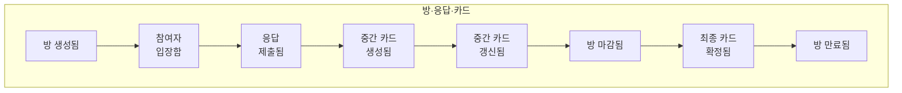
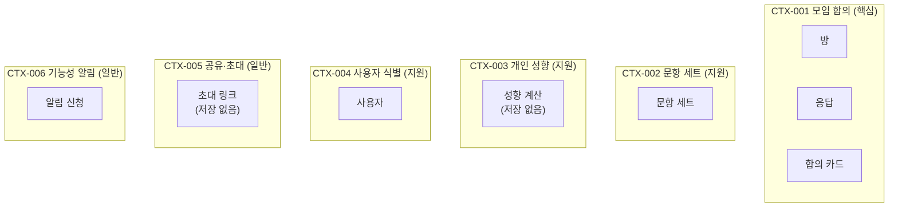

# 모임 합의 카드(가칭): 이벤트 스토밍 보드 (텍스트)

이 파일은 Miro 보드를 대신하는 저장소 안 텍스트 보드예요(2026-11-27). Miro 도구는 이 세션에 연결돼 있었지만, 이번 작업 지시가 저장소 밖 쓰기를 허용하지 않았고 보드 생성은 되돌릴 수 없어 사용자 확인 사항이라 만들지 않았어요. 단계마다 한 절(보드의 frame 하나)이고, 위에서 아래로 쌓여요. 정리된 결과는 [domain.md](domain.md)에 있어요.

- 진행 방식: one-pass draft. AI가 1~9단계를 한 번에 쓰고, 9단계 뒤 한 번만 사람이 확인해요.
- 신뢰도: 각 항목 끝의 `[확실]`(사용자님 말이나 문서) · `[추론]`(문서에서 끌어낸 판단) · `[추측]`(근거 없는 가정, 핫스팟이기도 함). 사람이 고치거나 확인하면 표시를 지워요.
- 모든 항목은 AI 제안이에요. 사람이 고친 항목은 아직 0개예요.

### 범례

| 요소 | Miro 색 | 이 텍스트 보드에서 |
| --- | --- | --- |
| 도메인 이벤트 | orange | 🟧 과거형 |
| 외부 시스템 | pink | 🟪 |
| 명령 | blue | 🟦 "~하기" |
| 핫스팟 | red | 🟥 H-번호 |
| 액터 | light_yellow | 🙂 |
| 애그리거트 | yellow | 🟨 |
| 정책 | violet | 🟣 "~이면, ~하기" |
| 리드 모델 | light_green | 🟩 |

## 0단계 준비

- **사용자님 말:** "A 모임 합의 카드" (2026-11-27 Orca 항목 222, 이벤트 e3467) [확실]
- **AI의 다시 쓰기:** 2~8명이 곧 갈 여행·회식·주말 약속에 대해 각자 문항 8개(둘 중 하나 + "상관없어요")에 답하면, 모두 좋다고 한 것 · 조율이 필요한 것 · 다음 행동 한 가지를 카드 한 장으로 받아요. 친구가 늦어도 응답한 사람은 '내 모임 성향'을 바로 받아요. [확실: 제안 문서]
- **누구를 위해:** 단톡방에서 모임을 정하는 20~30대 친구 3~6명. [확실: 제안 문서]
- **범위 안:** 방, 응답, 합의 카드, 내 모임 성향, 문항 세트, 사용자 식별과 데이터 삭제, 공유, 기능성 알림.
- **범위 밖:** 인앱 광고(자연 유입 방문자 500명 뒤), 인앱 결제·토스 로그인(사업자등록 뒤), 날짜 맞추기, 정산. 6결의 캐릭터·이미지·문항·문구·상표.
- **입력:** [제품 방향 제안](../00-research/proposal-2026-11-27.md), [토스 공식 자료 노트](../00-research/toss-official-2026-11-27.md), [6결 기록·코드 노트](../00-research/gyeol-records-and-code-2026-11-27.md), 6결 `engine.js`(읽기만).
- **제품 부분(part):** 하나뿐이에요.
- **체크포인트 질문:** [checkpoint-01.md](checkpoint-01.md)에 세 개를 번호와 추천안과 함께 두었어요.

> 용어 메모 — **이벤트 스토밍**: 제품에서 "일어난 일"을 포스트잇처럼 늘어놓고 그 원인과 규칙을 차례로 붙여 가는 설계 방법이에요. **도메인 이벤트**: 데이터가 바뀌는 일어난 일(예: "방 생성됨"). 조회·검색·로그인은 넣지 않아요.

## 1-a단계 이벤트

🟧 방 생성됨 [확실] · 🟧 참여자 입장함 [확실] · 🟧 응답 제출됨 [확실] · 🟧 중간 카드 생성됨 [확실] · 🟧 중간 카드 갱신됨 [추론] · 🟧 최종 카드 확정됨 [확실] · 🟧 방 마감됨 [추론] · 🟧 방 만료됨 [확실: 보관 기간] · 🟧 사용자 등록됨 [추론] · 🟧 내 데이터 삭제됨 [확실: 토스 노트] · 🟧 응답 삭제됨 [추론] · 🟧 문항 세트 초안 작성됨 [추론] · 🟧 문항 세트 검토 통과됨 [추론] · 🟧 문항 세트 반려됨 [추론] · 🟧 문항 세트 배포됨 [추론] · 🟧 알림 신청됨 [추론] · 🟧 알림 발송됨 [확실: 제안 문서]

**넣지 않은 것(이벤트가 아님):** 사용자 식별키 받기(로그인과 같은 조회), 카드 보기·저장(서버 데이터가 바뀌지 않음), 초대 링크 보내기(토스 공유 시트만 열림), 입장 거절(데이터가 바뀌지 않음, 규칙으로 둠), 내 모임 성향 보기(저장하지 않는 계산, H-10).

## 1-b단계 타임라인

| Lane | 한 줄 이야기 | Events |
| --- | --- | --- |
| 문항 세트 | 운영자가 테마별 문항을 쓰고 점검해 배포해요 | 문항 세트 초안 작성됨 → 문항 세트 검토 통과됨 or 문항 세트 반려됨 → 문항 세트 배포됨 |
| 사용자 | 앱을 처음 열면 등록되고, 원하면 내 데이터를 지워요 | 사용자 등록됨 → 내 데이터 삭제됨 |
| 방 | 방장이 방을 열고 친구가 들어와요. 다 답하면 닫히고, 기간이 지나면 지워져요 | 방 생성됨 → 참여자 입장함 → 방 마감됨 → 방 만료됨 |
| 응답 | 각자 문항 8개에 답해요 | 응답 제출됨 → 응답 삭제됨 |
| 합의 카드 | 두 번째 사람이 답하면 카드가 생기고, 다 답하면 확정돼요 | 중간 카드 생성됨 → 중간 카드 갱신됨 → 최종 카드 확정됨 |
| 알림 | 신청한 사람에게 "친구가 답을 마쳤어요"를 보내요 | 알림 신청됨 → 알림 발송됨 |

방·응답·카드 lane만 한 줄로 그렸어요: 두 번째 응답이 들어오는 순간(중간 카드 생성됨)이 대표 전환 지표 후보예요.

> 용어 메모 — **lane**: 같은 흐름의 일을 한 줄에 놓은 것. **중간 카드**: 아직 모두 답하지 않았을 때의 합의 카드. **최종 카드**: 마감 때 확정되어 바뀌지 않는 카드.

## 2-6단계 외부 시스템·명령·핫스팟·액터·애그리거트

| 🟧 이벤트 | 🟦 명령 | 🙂 액터 | 🟪 외부 시스템 | 🟨 애그리거트 | 🟥 핫스팟 |
| --- | --- | --- | --- | --- | --- |
| 방 생성됨 | 방 만들기 [확실] | 방장 [확실] | | 방 [추론] | H-01 인원을 정하나 → 답: 방장이 2~8명을 정함(DEC-003) |
| 참여자 입장함 | 방 입장하기 [확실] | 참여자 [확실] | 토스 앱 딥링크 `intoss://` [확실] | 방 [추론] | H-14 닉네임 비속어·내보내기 |
| 응답 제출됨 | 응답 제출하기 [확실] | 참여자 [확실] | | 응답 [추론] | H-05 제출 뒤 고치기 [추측] |
| 중간 카드 생성됨 / 갱신됨 | 카드 갱신하기 [추론] | 정책 | 앱인토스 분석(전환 지표) [확실: 토스 노트] | 합의 카드 [추론] | H-02 이름 표시 → 답: 수만(DEC-004), H-12 전환 지표 API |
| 방 마감됨 | 방 마감하기 [추론] | 방장, 정책 | | 방 [추론] | H-01 |
| 최종 카드 확정됨 | 최종 카드 확정하기 [추론] | 정책 | | 합의 카드 [추론] | H-08 응답 안 한 사람의 열람 |
| 방 만료됨 | 방 만료시키기 [추론] | 정책 | 스케줄러(Cloudflare Cron Trigger) [추론] | 방 [추론] | H-04 보관 기간 30일 [추측] |
| 사용자 등록됨 | 사용자 식별하기 [추론] | 참여자 | 앱인토스 SDK 식별키·파트너 API(mTLS) [확실: 토스 노트] | 사용자 [추론] | H-11 mTLS를 쓸 수 있나 [추측] |
| 내 데이터 삭제됨 | 내 데이터 지우기 [확실: 토스 노트] | 참여자 | | 사용자 [추론] | H-06, H-07 [추측] |
| 응답 삭제됨 | 응답 지우기 [추론] | 정책 | | 응답 [추론] | H-06 |
| 문항 세트 초안 작성됨 | 문항 세트 작성하기 [추론] | 운영자 [추론] | | 문항 세트 [추론] | H-09 번들이냐 서버냐 |
| 문항 세트 검토 통과됨 / 반려됨 | 문항 세트 검토하기 [추론] | 운영자 | | 문항 세트 | |
| 문항 세트 배포됨 | 문항 세트 배포하기 [추론] | 운영자 | | 문항 세트 | |
| 알림 신청됨 | 알림 신청하기 [추론] | 참여자 | | 알림 신청 [추론] | H-13 첫 버전에 넣나 |
| 알림 발송됨 | 알림 보내기 [추론] | 정책 | 앱인토스 푸시·알림 [확실: 토스 노트] | 알림 신청 | |

- 한 명령이 이벤트 여럿을 내는 transaction 후보: 네 번째(마지막) 응답의 응답 제출하기 → 응답 제출됨 + 방 마감됨 + 최종 카드 확정됨. [추론]
- 애그리거트 규칙 초안은 [domain.md 4절](domain.md#4-컨텍스트-표)에 있어요. 예: 🟨 합의 카드 — "응답 완료 2명 이상일 때만 생기고, 다음 행동은 정확히 하나" [확실: 제안 문서].

> 용어 메모 — **명령**: 이벤트를 일으키는 요청. **액터**: 명령을 내리는 사람. **외부 시스템**: 우리 제품 밖에서 이벤트를 주고받는 시스템(여기서는 토스). **애그리거트**: 명령을 받아 규칙을 지키는 단위(예: 방은 "8명까지"를 지켜요). **핫스팟**: 아직 답이 없는 질문이나 위험.

## 7단계 바운디드 컨텍스트

컨텍스트 6개와 그 안의 애그리거트예요: 핵심은 CTX-001 하나이고, 저장하지 않는 계산·감싸는 계층은 따로 뺐어요.

- 나눈 기준: "합의·조율"(여러 사람의 응답을 겹쳐 봄)과 "성향·축"(한 사람의 응답을 설명함)은 말이 달라 둘로 나눴어요. [추론]
- 사용자 식별과 데이터 삭제는 토스 식별키를 감싸는 일이라 따로 두었어요. [추론]

> 용어 메모 — **바운디드 컨텍스트**: 같은 말이 같은 뜻으로 쓰이는 범위. 나중에 코드 패키지 후보가 돼요. 핵심(core)은 제품의 차별점, 지원(supporting)은 차별점을 돕는 것, 일반(generic)은 다른 제품에서도 비슷한 것이에요.

## 8단계 정책·리드 모델·컨텍스트 맵

### 🟣 정책

| 정책 | 경계를 넘나 |
| --- | --- |
| 응답 제출됨이고 응답 완료가 2명 이상이면, 카드 갱신하기 [확실: 제안 문서] | 아니요 |
| 응답 완료 수가 인원에 닿으면, 방 마감하기 [추론] | 아니요 |
| 방 마감됨이면, 최종 카드 확정하기 [추론] | 아니요 |
| 보관 기간이 지나면, 방 만료시키기 [추론] | 스케줄러 → CTX-001 |
| 내 데이터 삭제됨이면, 응답 지우기 [추론] | CTX-004 → CTX-001 |
| 내 데이터 삭제됨이면, 알림 신청 지우기 [추론] | CTX-004 → CTX-006 |
| 응답 제출됨이면, 신청한 다른 참여자에게 알림 보내기 [확실: 제안 문서] | CTX-001 → CTX-006 |
| 처음 중간 카드 생성됨이면, 대표 전환 기록하기 [확실: 제안 문서] | CTX-001 → 앱인토스 분석 |

### 🟩 리드 모델

| 리드 모델 | 누가 보고 | 다음 명령 |
| --- | --- | --- |
| 테마 목록 | 방장 | 방 만들기 |
| 방 소개(모임 이름·테마·인원·응답 완료 수·상태) | 참여자 | 방 입장하기 |
| 문항 화면 | 참여자 | 응답 제출하기 |
| 응답 현황(응답 완료 수) | 방장 | 방 마감하기 |
| 합의 카드 보기 | 응답을 마친 참여자 | 초대 링크 보내기, 다른 모임 만들기 |
| 내 모임 성향 | 응답을 마친 참여자 | 초대 링크 보내기 |
| 지난 카드 목록("지난번엔 이렇게 정했어요") | 참여자 | 방 만들기 |
| 내 데이터 현황 | 참여자 | 내 데이터 지우기 |

### 컨텍스트 맵

[domain.md 5절](domain.md#5-컨텍스트-사이-의존-관계)에 표와 Mermaid 그림이 있어요. 경계를 넘는 정책은 CTX-004와 CTX-001 쪽에 두 개가 모였지만, 한쪽은 동기 호출(사용자 ID 확인), 반대쪽은 비동기 이벤트(데이터 삭제)라 원을 이루지 않아요.

> 용어 메모 — **정책**: "어떤 이벤트가 생기면 어떤 명령을 한다"는 자동 규칙. **리드 모델**: 사람이 명령을 내리기 전에 보는 정보. **컨텍스트 맵**: 컨텍스트끼리 무엇을 주고받는지 그린 그림. 실선은 바로 답을 기다리는 호출, 점선은 알리고 끝나는 이벤트예요.

## 9단계 컨텍스트 표

표가 커서 보드에는 명령 이름만 두고, 전체 표와 Given–When–Then 예시는 [domain.md 4절](domain.md#4-컨텍스트-표)에 있어요.

- CTX-001: 방 만들기 · 방 입장하기 · 응답 제출하기 · 카드 갱신하기 · 방 마감하기 · 최종 카드 확정하기 · 응답 지우기 · 방 만료시키기
- CTX-002: 문항 세트 작성하기 · 문항 세트 검토하기 · 문항 세트 배포하기
- CTX-003: 명령 없음(계산만)
- CTX-004: 사용자 식별하기 · 내 데이터 지우기
- CTX-005: 명령 없음(토스 공유를 감쌈)
- CTX-006: 알림 신청하기 · 알림 보내기

**체크포인트(1번뿐):** [checkpoint-01.md](checkpoint-01.md) — 상태: 통과(2026-11-27, NEXUS에서 그린 대로 확정, DEC-006). 답한 핫스팟: H-01 → DEC-003, H-02 → DEC-004, H-03 → DEC-005(모두 추천안 1, 사용자님 "질문 3개 추천대로", Orca 항목 232).
