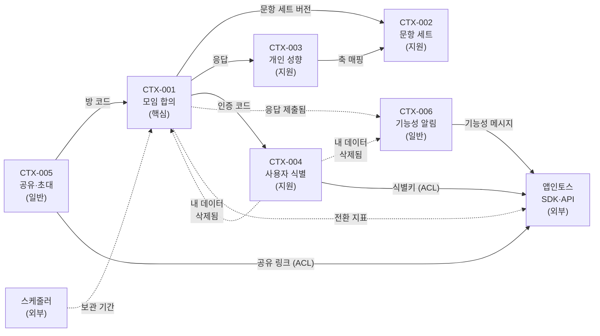

# 모임 합의 카드(가칭): 도메인 설계

상태: 1~9단계 초안 완료(one-pass draft), **체크포인트 대기**(2026-11-27, 사용자님 확인 전). 이 문서의 CTX·TERM ID는 체크포인트 전에 붙인 초안 ID예요. 체크포인트에서 빠지는 항목은 번호를 다시 쓰지 않고 "삭제됨"으로 표시해요.

신뢰도 표시: `[확실]` 사용자님 말이나 문서가 뒷받침함 · `[추론]` 문서에서 끌어낸 판단 · `[추측]` 근거 없는 가정(모두 6절 핫스팟에도 있음).

## 1. 서비스 개요

**사용자님 말 (원문):** "A 모임 합의 카드" — 2026-11-27 Orca 항목 222, 이벤트 e3467. 사용자님이 [제품 방향 제안](../00-research/proposal-2026-11-27.md)의 세 방향 중 A를 고른 말이에요.

**AI의 다시 쓰기:** 2~8명이 곧 갈 여행·회식·주말 약속에 대해 각자 문항 8개(둘 중 하나 + "상관없어요")에 답하면, 모두 좋다고 한 것 · 조율이 필요한 것 · 다음 행동 한 가지를 합의 카드 한 장으로 받아요. 방장이 방을 만들고 초대 링크(`intoss://`)로 친구를 불러요. 친구가 아직 답하지 않아도 응답을 마친 사람은 '내 모임 성향'을 바로 받아요. 로그인 없이 토스의 사용자 식별키(`User.getAnonymousKey`)로 사용자를 구분하고, 방 상태는 작은 서버(Cloudflare Workers + D1)에 둬요. [확실: 제안 문서·작업 지시]

- 방장: 방을 만들고 인원을 정하고, 초대 링크를 단톡방에 보내고, 필요하면 방을 일찍 마감해요.
- 참여자: 초대 링크로 들어와 닉네임을 정하고 문항에 답한 뒤, 내 모임 성향과 합의 카드를 받아요. 방장도 참여자예요.
- 운영자: 테마별 문항 세트를 쓰고 혐오·차별 소재를 점검한 뒤 배포해요.
- 토스 앱·앱인토스 SDK(외부 시스템): 사용자 식별키, 공유 링크, 기능성 알림, 전환 지표를 제공해요.

**범위:** 방·응답·합의 카드·내 모임 성향·문항 세트·사용자 식별과 데이터 삭제·공유·기능성 알림. **범위 밖:** 인앱 광고(자연 유입 방문자 500명 이후), 인앱 결제·토스 로그인(사업자등록 이후), 일정(날짜) 맞추기, 정산. 테마는 한 앱 안에 두어요(같은 워크스페이스 중복 앱 정책). [확실: 제안 문서·토스 노트]

**쓰지 않는 것:** 6결의 캐릭터·이미지·문항·문구·상표. 채점·비교 엔진 로직(순수 함수, 같은 입력이면 같은 결과)만 참고해요. [확실: 작업 지시]

## 2. 이벤트 스토밍

- 보드: [board.md](board.md) (저장소 안 텍스트 보드, Mermaid 포함). **Miro 보드는 만들지 않았어요.** 이 세션에서 Miro 도구는 연결돼 있었지만(2026-11-27 로그인 확인), 이번 작업 지시가 저장소 밖 쓰기를 허용하지 않았고 보드 생성은 되돌릴 수 없어 사용자 확인 사항이에요. 보드를 Miro로 옮길지는 체크포인트에서 사용자님이 정해요.
- 단계: [0 준비](board.md#0단계-준비) · [1-b 타임라인](board.md#1-b단계-타임라인) · [2~6 외부 시스템·명령·핫스팟·액터·애그리거트](board.md#2-6단계-외부-시스템명령핫스팟액터애그리거트) · [7 바운디드 컨텍스트](board.md#7단계-바운디드-컨텍스트) · [8 정책·리드 모델·컨텍스트 맵](board.md#8단계-정책리드-모델컨텍스트-맵) · [9 컨텍스트 표](#4-컨텍스트-표)
- 진행 방식: **one-pass draft** — AI가 1~9단계를 한 번에 초안으로 쓰고, 사람은 9단계 뒤 한 번만 확인해요. 스킬이 허용하는 세 방식(draft and correct 3번, workshop 9번 이상, one-pass draft 1번) 중 사람 확인 횟수가 가장 적어요. 고른 근거: 사용자님은 휴대폰으로 보고 DDD를 직접 확인하길 원한다는 작업 지시(2026-11-27). 이 방식은 앞 단계 실수가 뒤까지 이어져 끝에서 보기 어렵다는 약점이 있어서, 체크포인트에 추측과 핵심 규칙을 모아 올려요.
- 체크포인트 내용(추측·질문·핵심 규칙): [checkpoint-01.md](checkpoint-01.md)
- 체크포인트 기록: 아직 없음(대기 중). 사람이 보드에서 고친 항목 0개, 댓글 0개.

### 타임라인

| Lane | Events |
| --- | --- |
| 문항 세트 | 문항 세트 초안 작성됨 → 문항 세트 검토 통과됨 or 문항 세트 반려됨 → 문항 세트 배포됨 |
| 사용자 | 사용자 등록됨 → 내 데이터 삭제됨 |
| 방 | 방 생성됨 → 참여자 입장함 → 방 마감됨 → 방 만료됨 |
| 응답 | 응답 제출됨 → 응답 삭제됨 |
| 합의 카드 | 중간 카드 생성됨 → 중간 카드 갱신됨 → 최종 카드 확정됨 |
| 알림 | 알림 신청됨 → 알림 발송됨 |

## 3. 바운디드 컨텍스트와 패키지

| Context | Type | Aggregates | Package |
| --- | --- | --- | --- |
| CTX-001 모임 합의 | core | 방(Room), 응답(Response), 합의 카드(ConsensusCard) | `consensus` |
| CTX-002 문항 세트 | supporting | 문항 세트(QuestionSet) | `question-set` |
| CTX-003 개인 성향 | supporting | 없음 — 상태를 저장하지 않는 계산 | `profile` |
| CTX-004 사용자 식별·데이터 관리 | supporting | 사용자(User) | `identity` |
| CTX-005 공유·초대 | generic | 없음 — 토스 공유 API를 감싸는 계층 | `share` |
| CTX-006 기능성 알림 | generic | 알림 신청(NotificationSubscription) | `notification` |

- CTX-001이 핵심(core)인 이유: 제품의 차별점이 "비교"가 아니라 "합의 카드와 다음 행동"이에요. [확실: 제안 문서]
- CTX-003을 CTX-001과 나눈 이유: "축·성향·구간"이라는 말은 한 사람의 응답을 설명하고, "모두 좋아요·조율해요"는 여러 사람의 응답을 겹쳐 봐요. 같은 응답을 읽지만 말과 규칙이 달라요. [추론]

## 4. 컨텍스트 표

### CTX-001 모임 합의

목적: 한 모임의 방을 열고, 참여자의 응답을 모아 합의 카드를 만들어요.

| Given by | Read model | Command | Aggregate | Events |
| --- | --- | --- | --- | --- |
| 방장 | 테마 목록 (CTX-002) | 방 만들기 | 방 | 방 생성됨 |
| 참여자 (CTX-005의 딥링크 진입) | 방 소개 | 방 입장하기 | 방 | 참여자 입장함 (마감·만료·8명 초과면 거절, 이벤트 없음) |
| 참여자 | 문항 화면 (CTX-002) | 응답 제출하기 | 응답 | 응답 제출됨 |
| 정책: 응답 제출됨이고 응답 완료가 2명 이상일 때 | | 카드 갱신하기 | 합의 카드 | 중간 카드 생성됨, 또는 중간 카드 갱신됨 |
| 정책: 응답 완료 수가 인원에 닿았을 때 | | 방 마감하기 | 방 | 방 마감됨 |
| 방장 | 응답 현황 | 방 마감하기 | 방 | 방 마감됨 |
| 정책: 방 마감됨 | | 최종 카드 확정하기 | 합의 카드 | 최종 카드 확정됨 |
| 정책: 내 데이터 삭제됨 (CTX-004) | | 응답 지우기 | 응답 | 응답 삭제됨 |
| 정책: 보관 기간 지남 (스케줄러) | | 방 만료시키기 | 방 | 방 만료됨 |

- Aggregate rules:
  - 방: 방은 테마 하나와 문항 세트 버전 하나를 가지며, 만든 뒤에는 바꿀 수 없어요. 같은 방의 응답은 모두 같은 문항으로 비교돼야 하기 때문이에요. (추론)
  - 방: 방장이 만들 때 인원을 2~8명으로 정하고, 방장은 첫 참여자예요. 입장은 최대 8명까지예요. (인원 범위는 문서 — 제안·작업 지시, 인원 지정 방식은 추론 · 질문 1)
  - 방: 한 사용자는 한 방에 한 번만 참여해요(사용자 ID 기준). (추론)
  - 방: 마감되거나 만료된 방에는 입장하거나 응답할 수 없어요. (추론)
  - 방: 방장은 응답 완료가 2명 이상일 때만 일찍 마감할 수 있어요. (추론 · 질문 1)
  - 응답: 한 응답은 그 방 문항 세트의 문항 8개 모두에 선택지 A, 선택지 B, "상관없어요" 중 하나씩 답해야 제출돼요. (문서 — 제안)
  - 응답: 응답을 제출하기 전에는 다른 사람의 응답이나 합의 카드를 볼 수 없어요. (추론)
  - 합의 카드: 응답 완료가 2명 이상일 때만 만들어지고, 응답 완료가 인원에 닿거나 방장이 마감하면 최종 카드로 확정돼요. 최종 카드는 다시 바뀌지 않아요. (2명·최종 조건은 문서 — 제안, 확정 뒤 불변은 추론)
  - 합의 카드: 문항마다 응답을 세어 분류해요. 선택지 A와 B가 각각 1명 이상이면 "조율해요", 한 선택지와 "상관없어요"만 있으면 "모두 좋아요", 모두 "상관없어요"면 "누구나 괜찮아요"예요. (추론)
  - 합의 카드: 다음 행동은 정확히 하나예요. "조율해요" 문항 중 가장 팽팽한 것(두 선택지 수의 차가 가장 작은 것, 같으면 문항 순서가 앞선 것)의 조율 제안 문구를 써요. "조율해요" 문항이 없으면 첫 "모두 좋아요" 문항의 확정 문구를 써요. (하나라는 것은 문서 — 제안, 고르는 규칙은 추론)
  - 합의 카드: 카드에는 누가 무엇을 골랐는지 이름을 쓰지 않고 수만 써요(예: "2 대 2"). 사람을 점수로 줄 세우거나 궁합 점수를 보이지 않아요. (줄 세우지 않기는 문서 — 제안·토스 정책, 이름 숨김은 추론 · 질문 2)
  - 합의 카드: 같은 응답과 같은 문항 세트 버전이면 언제 계산해도 같은 카드가 나와요(순수 함수). (추론 — 6결 엔진 원칙)
- Given–When–Then: Given 테마 '여행'의 문항 세트 v1이 배포됨, When 방장이 모임 이름 "제주 3박"·인원 4로 방 만들기, Then 방 생성됨(방 코드 발급, 문항 세트 v1 고정, 방장이 첫 참여자).
- Given–When–Then: Given 인원 4명이 모두 응답해 마감된 방, When 새 사용자가 초대 링크로 방 입장하기, Then 입장이 거절되고(사유: 마감) 참여자 입장함은 생기지 않음.
- Given–When–Then: Given 문항 8개 중 7개만 고른 참여자, When 응답 제출하기, Then 제출이 거절되고 응답 제출됨은 생기지 않음.
- Given–When–Then: Given 인원 4인 방에서 1명만 응답 완료, When 두 번째 참여자의 응답 제출됨, Then 중간 카드 생성됨(응답 2명 기준).
- Given–When–Then: Given 응답 4명 중 "도착 첫날 저녁은?"에 2명은 '맛집 줄 서기', 2명은 '숙소 근처 아무 데나', 다른 문항은 모두 좋아요, When 카드 갱신하기, Then 그 문항은 "조율해요 (2 대 2)"이고 다음 행동은 그 문항의 조율 제안 문구.
- Given–When–Then: Given 응답 완료 1명, When 방장이 방 마감하기, Then 마감이 거절됨(2명 이상 필요).
- Given–When–Then: Given 인원 4·응답 완료 3, When 네 번째 응답 제출됨, Then 방 마감됨과 최종 카드 확정됨.
- External systems: 토스 앱·앱인토스 분석(전환 지표, conformist), 스케줄러(Cloudflare Cron Trigger, 만료 처리)
- Links: CTX-002에서 문항 세트를 읽음, CTX-003에 내 모임 성향 계산을 요청함, CTX-004에서 사용자 ID를 받음, CTX-004의 내 데이터 삭제됨을 따름, CTX-005가 방 입장하기를 부름, CTX-006에 응답 제출됨을 알림
- Hotspots: H-01, H-02, H-03, H-04, H-05, H-06, H-07, H-08, H-12

### CTX-002 문항 세트

목적: 테마별 문항 세트를 쓰고, 점검하고, 버전으로 배포해요.

| Given by | Read model | Command | Aggregate | Events |
| --- | --- | --- | --- | --- |
| 운영자 | | 문항 세트 작성하기 | 문항 세트 | 문항 세트 초안 작성됨 |
| 운영자 | 점검 목록 | 문항 세트 검토하기 | 문항 세트 | 문항 세트 검토 통과됨, 또는 문항 세트 반려됨 |
| 운영자 | | 문항 세트 배포하기 | 문항 세트 | 문항 세트 배포됨 |

- Aggregate rules: 문항 세트: 테마 하나에 문항 8개, 각 문항은 선택지 2개와 "상관없어요"를 가지며, 문항마다 조율 제안 문구와 선택지별 확정 문구, 성향 축(없을 수 있음)을 가져요. 배포된 버전은 바꾸지 않고 새 버전으로 내요. 검토를 통과한 세트만 배포해요. 정치 성향, 성별·외모·세대·지역 고정관념 같은 혐오·차별 소재와 6결 콘텐츠는 쓰지 않아요. 모든 문구는 해요체예요. 세트마다 작성자·작성일·원본 파일을 권리 증빙으로 남겨요. (8문항·선택지 형식은 문서 — 제안, 금지 소재·해요체는 문서 — 토스 노트, 버전 불변·권리 증빙은 추론)
- External systems: 없음
- Links: CTX-001과 CTX-003이 배포된 문항 세트를 읽음(published language)
- Hotspots: H-09

### CTX-003 개인 성향

목적: 한 사람의 응답으로 '내 모임 성향' 한 줄과 3개 축(계획 속도, 지출 우선순위, 일정 변경 반응)을 계산해요. 상태를 저장하지 않아 명령과 이벤트가 없고, CTX-001의 계산 요청에 답해요. [추론]

| Given by | Read model | Command | Aggregate | Events |
| --- | --- | --- | --- | --- |
| CTX-001 (계산 요청) | 응답, 문항 세트의 축 매핑 | (명령 없음 — 계산만) | 없음 | 없음 |

- Aggregate rules: 성향 계산: 축마다 그 축에 묶인 문항의 응답만 쓰고, "상관없어요"는 가운데 값으로 셈해요. 결과는 낮음·균형·높음 구간과 설명 문장으로 보여 주고, 사람을 유형 이름이나 점수로 단정하지 않아요. 'MBTI' 같은 남의 검사 이름은 쓰지 않아요. (3개 축은 문서 — 제안, 계산 방식은 추론 — 6결 축 점수·구간 원리, 이름 금지는 문서 — 6결 노트)
- External systems: 없음
- Links: CTX-001이 부름(동기 호출), CTX-002의 축 매핑을 읽음
- Hotspots: H-10

### CTX-004 사용자 식별·데이터 관리

목적: 로그인 없이 사용자를 구분하고, 사용자가 원하면 그 사람의 데이터를 지워요.

| Given by | Read model | Command | Aggregate | Events |
| --- | --- | --- | --- | --- |
| 참여자 (앱 첫 실행) | | 사용자 식별하기 | 사용자 | 사용자 등록됨 (처음일 때만) |
| 참여자 | 내 데이터 현황 | 내 데이터 지우기 | 사용자 | 내 데이터 삭제됨 |

- Aggregate rules: 사용자: 사용자 식별키는 서버에 그대로 두지 않고 내부 사용자 ID로 바꿔 써요. 서버는 클라이언트가 보낸 식별키를 그대로 믿지 않아요. 실명·전화번호·연락처는 받지 않아요. 식별키만 쓰면 탈퇴 콜백이 없으므로 '내 데이터 지우기'를 앱 안에 둬요. (식별키 신뢰 금지·탈퇴 콜백 없음은 문서 — 토스 노트, 내부 ID 치환은 추론)
- External systems: 앱인토스 SDK `User.getAnonymousKey`·`User.createAnonymousKeyAuthCode`, 앱인토스 파트너 API(mTLS, 인증 코드 교환) — anticorruption layer
- Links: CTX-001에 사용자 ID를 줌, 내 데이터 삭제됨을 CTX-001·CTX-006에 알림
- Hotspots: H-11

### CTX-005 공유·초대

목적: 방 코드만 담은 `intoss://` 초대 링크를 만들고, 딥링크로 들어온 사람을 방 입장으로 보내요. 토스 공유 API(`Share.createLink`, `Share.sendMessage`)를 anticorruption layer로 감싸요. 상태를 저장하지 않아요. [추론]

- 하는 일: 방장·참여자가 '친구 부르기'나 '단톡방에 보내기'를 누르면 초대 링크를 만들고 토스 공유 시트를 열어요. 우리 데이터를 바꾸지 않으므로 도메인 이벤트가 없어요. 공유율은 토스의 유입 경로 값(`referrer`의 `external_share`)으로 셀 수 있어요. [추론]
- 규칙: 링크에는 방 코드 하나만 넣고 응답·닉네임은 넣지 않아요. OG 이미지는 1200×600px이에요. 자사 웹사이트로 보내지 않아요. (문서 — 토스 노트)

### CTX-006 기능성 알림

목적: 참여자가 신청한 경우에만 "친구가 답을 마쳤어요" 같은 기능성 메시지를 보내요. 토스 푸시·알림 API에 conformist로 맞춰요.

| Given by | Read model | Command | Aggregate | Events |
| --- | --- | --- | --- | --- |
| 참여자 | | 알림 신청하기 | 알림 신청 | 알림 신청됨 |
| 정책: 응답 제출됨 (CTX-001) | | 알림 보내기 | 알림 신청 | 알림 발송됨 |

- Aggregate rules: 알림 신청: 신청한 사람에게만, 자기 응답이 아닌 다른 사람의 응답 완료만 알려요. 광고성·리텐션 문구는 보내지 않아요. 진입 직후 동의를 묻지 않아요. (문서 — 토스 노트)
- Hotspots: H-13

## 5. 컨텍스트 사이 의존 관계

| From | To | Kind | Pattern | Why | Data |
| --- | --- | --- | --- | --- | --- |
| CTX-001 | CTX-002 | call (sync) | conformist | 방을 만들 때 문항 세트를 고정하고 문항 화면을 그림 | 테마, 문항 세트 버전, 문항 |
| CTX-001 | CTX-003 | call (sync) | open host service | 응답을 마친 사람에게 내 모임 성향을 보여 줌 | 응답, 문항 세트 버전 |
| CTX-003 | CTX-002 | call (sync) | conformist | 축 매핑을 읽음 | 문항 세트 버전 |
| CTX-001 | CTX-004 | call (sync) | customer and supplier | 요청한 사람의 사용자 ID를 확인함 | 인증 코드 → 사용자 ID |
| CTX-004 | CTX-001 | event (async) | | 내 데이터 삭제됨이면 그 사람의 응답을 지움 | 사용자 ID |
| CTX-004 | CTX-006 | event (async) | | 내 데이터 삭제됨이면 알림 신청을 지움 | 사용자 ID |
| CTX-005 | CTX-001 | call (sync) | | 딥링크로 들어온 사람을 방 입장하기로 보냄 | 방 코드 |
| CTX-001 | CTX-006 | event (async) | | 응답 제출됨이면 신청한 참여자에게 알림 | 방 코드, 응답 완료 수 |
| CTX-004 | 앱인토스 SDK·파트너 API | call (sync) | anticorruption layer | 식별키 발급과 인증 코드 교환 | 인증 코드, 식별키 |
| CTX-005 | 앱인토스 SDK 공유 | call (sync) | anticorruption layer | 초대 링크 만들기와 공유 시트 | `intoss://` 경로, 방 코드, OG 이미지 주소 |
| CTX-006 | 앱인토스 푸시·알림 | call (sync) | conformist | 기능성 메시지 발송 | 템플릿 ID, 사용자 |
| CTX-001 | 앱인토스 분석 | event (async) | conformist | 대표 전환 "두 번째 사람이 응답을 마쳐 카드가 만들어진 순간" 기록 | 중간 카드 생성됨(첫 번째만) |
| 스케줄러 | CTX-001 | event (async) | | 보관 기간이 지난 방을 만료시킴 | 시각 |

- 동기 호출이 원을 이루는 곳은 없어요. CTX-001↔CTX-004는 한쪽이 동기 호출, 반대쪽이 비동기 이벤트예요.

컨텍스트 맵: 모든 화살표가 CTX-001 모임 합의를 중심으로 모이고, 외부 시스템(앱인토스)은 세 개의 감싸는 계층(ACL)과 지표 하나로만 닿아요. 실선은 동기 호출, 점선은 비동기 이벤트예요.

## 6. 핫스팟

| Hotspot | Context | State | Answer or next step |
| --- | --- | --- | --- |
| H-01 최종 카드는 언제 확정되나: 방장이 처음에 인원을 정하나, 방장이 '마감'을 누를 때인가 | CTX-001 | open | 체크포인트 질문 1. 추천: 인원을 정하고, 2명 이상이면 일찍 마감 가능 |
| H-02 합의 카드에 누가 무엇을 골랐는지 이름을 보여 주나 | CTX-001 | open | 체크포인트 질문 2. 추천: 수만 보여 줌 |
| H-03 혼자 받는 '내 모임 성향'의 입구: 방 안에서만인가, 방 없이 혼자 하기를 따로 두나 | CTX-001, CTX-003 | open | 체크포인트 질문 3. 추천: 방 안에서만(방장이 먼저 답하면 혼자서도 받음) |
| H-04 [추측] 보관 기간: 방과 응답은 만든 날부터 30일 뒤 지우고, 최종 카드 요약(이름 없는 수와 문구)은 참여자의 '지난 카드' 목록에 남김 | CTX-001 | open | 체크포인트 추측으로 올림. 02 PRD 전에 답 필요 |
| H-05 [추측] 응답은 제출한 뒤 마감 전까지 고칠 수 있나 | CTX-001 | open | 초안은 고칠 수 없음으로 둠. 02 PRD에서 다시 봄 |
| H-06 [추측] 참여자가 내 데이터를 지우면 이미 확정된 최종 카드는 어떻게 되나 | CTX-001 | open | 초안: 최종 카드는 이름 없는 수라 그대로 두고, 열린 방의 중간 카드는 다시 계산. 02 PRD 전에 답 필요 |
| H-07 [추측] 방장이 내 데이터를 지우면 방은 어떻게 되나 | CTX-001 | open | 초안: 방을 마감하고 남은 참여자는 카드만 봄. 02 PRD에서 다시 봄 |
| H-08 입장은 했지만 응답하지 않은 사람은 마감 뒤 카드를 볼 수 있나 | CTX-001 | open | 초안: 볼 수 없음(응답 전 열람 금지 규칙). 02 PRD에서 다시 봄 |
| H-09 문항 세트를 앱 번들에 넣나, 서버에서 내려 주나 | CTX-002 | open | 토스 노트의 추정: 서버에서 내려 주면 번들 재검수 없이 테마 추가 가능(직접 답변은 아님). 06 API 전에 확인 |
| H-10 [추측] 내 모임 성향을 저장하나, 응답에서 매번 계산하나 | CTX-003 | open | 초안: 저장하지 않고 계산. 저장하면 CTX-003에 "내 모임 성향 산출됨" 이벤트를 더함 |
| H-11 [추측] 파트너 API의 인증 코드 교환(mTLS)을 사업자등록 없이 쓸 수 있나, Cloudflare Workers에서 mTLS 클라이언트 인증서를 쓸 수 있나 | CTX-004 | open | 공식 문서 확인 필요(05 ERD·06 API 전). 안 되면 식별키를 그대로 믿지 않는 다른 방법이 필요 |
| H-12 대표 전환 지표를 어떤 API로 기록하나 | CTX-001 | open | 공식 문서 확인 필요 |
| H-13 기능성 알림을 첫 버전에 넣나 (템플릿 검수·알림 동의문 필요) | CTX-006 | open | 02 PRD에서 범위 결정 |
| H-14 닉네임에 비속어가 들어오면 어떻게 하나, 방장이 참여자를 내보낼 수 있나 | CTX-001 | open | 02 PRD에서 다시 봄 |
| 방 애그리거트 규칙 전부 (4절) | CTX-001 | review in stage 02 | 체크포인트에서 확인 전. 승인돼도 사람 수정이 없으면 02에서 다시 봄 |
| 응답 애그리거트 규칙 전부 (4절) | CTX-001 | review in stage 02 | 위와 같음 |
| 합의 카드 애그리거트 규칙 전부 (4절) | CTX-001 | review in stage 02 | 위와 같음 |

### 빠진 것 점검

비교 목록: 토스 노트 8절의 유사 앱(언제모여: 가능한 시간 모으기, 같이메뉴: 싫은 건 빼고 메뉴 정하기, 싱크픽: 서로 모르게 고르고 함께 공개)과 토스 노트 3절의 비게임 출시 체크리스트.

- 싱크픽의 "함께 공개" → 응답 전 열람 금지 규칙으로 넣었어요. [추론]
- 언제모여의 날짜 맞추기 → 범위 밖으로 두었어요. 넣으려면 새 컨텍스트가 필요해요.
- 같이메뉴의 "싫은 건 빼기"(거부권) → 넣지 않았어요. 선택지가 둘이라 "조율해요"로 대신해요.
- 체크리스트의 진입 직후 바텀시트 금지·뒤로가기 → 화면 규칙이라 02 이후로 넘겨요.

## 7. 용어집

| ID | Term | Definition | Context | Code name | Avoid |
| --- | --- | --- | --- | --- | --- |
| TERM-001 | 모임 | 2~8명이 함께 가는 여행·회식·주말 약속 같은 실제 약속 하나 | CTX-001 | `gathering` | 이벤트, 파티 |
| TERM-002 | 방 | 모임 하나를 위해 만든 온라인 공간. 테마·문항 세트 버전·인원·상태를 가짐 | CTX-001 | `Room` | 채팅방, 세션, 그룹 |
| TERM-003 | 방 코드 | 방을 가리키는 짧은 공개 코드. 초대 링크에 들어가는 유일한 값 | CTX-001, CTX-005 | `roomCode` | 초대 코드, 방 번호 |
| TERM-004 | 방장 | 방을 만든 참여자. 인원을 정하고 일찍 마감할 수 있음 | CTX-001 | `host` | 관리자, 오너 |
| TERM-005 | 참여자 | 방에 들어온 사용자. 방장도 참여자임 | CTX-001 | `Participant` | 회원, 멤버 |
| TERM-006 | 인원 | 방장이 정한 모임 사람 수(2~8). 응답 완료가 인원에 닿으면 최종 카드가 됨 | CTX-001 | `partySize` | 정원 |
| TERM-007 | 테마 | 문항 세트의 주제. 여행, 회식·저녁, 주말 나들이 | CTX-002 | `theme` | 카테고리(토스 앱 카테고리와 헷갈림) |
| TERM-008 | 문항 세트 | 테마 하나에 속한 문항 8개와 그 문구 전체. 버전으로 배포됨 | CTX-002 | `QuestionSet` | 퀴즈, 테스트 |
| TERM-009 | 문항 | 둘 중 하나를 고르는 질문 하나. 화면에는 "질문"으로 보일 수 있음 | CTX-002 | `Question` | 퀴즈 문제 |
| TERM-010 | 선택지 | 문항의 두 답 A, B | CTX-002 | `option` | 보기 |
| TERM-011 | 상관없어요 | 어느 선택지든 괜찮다는 답. 선택지 수에 세지 않음 | CTX-001, CTX-002 | `noPreference` | 중립, 패스, 기권 |
| TERM-012 | 응답 | 참여자 한 명이 한 방의 문항 8개에 한 답 전체 | CTX-001 | `Response` | 답안, 답지(정답이 있다는 뜻) |
| TERM-013 | 응답 완료 | 응답을 제출한 상태. 카드 계산에 들어가는 조건 | CTX-001 | `submitted` | 완주 |
| TERM-014 | 합의 카드 | 응답들을 겹쳐 모두 좋아요·조율해요·다음 행동을 한 장으로 보여 주는 결과 | CTX-001 | `ConsensusCard` | 궁합 카드, 결과지, 점수표 |
| TERM-015 | 중간 카드 | 응답 완료 2명 이상, 인원 미만일 때의 합의 카드. 응답이 늘면 갱신됨 | CTX-001 | `interim` | 임시 결과 |
| TERM-016 | 최종 카드 | 마감 때 확정되어 다시 바뀌지 않는 합의 카드 | CTX-001 | `final` | 완성본 |
| TERM-017 | 모두 좋아요 | 한 선택지와 "상관없어요"만 나온 문항의 분류 | CTX-001 | `agreed` | 일치, 궁합 |
| TERM-018 | 조율해요 | 두 선택지가 각각 1명 이상 나온 문항의 분류 | CTX-001 | `split` | 충돌, 불일치, 갈등 |
| TERM-019 | 누구나 괜찮아요 | 모두 "상관없어요"인 문항의 분류 | CTX-001 | `open` | 무관심 |
| TERM-020 | 다음 행동 | 카드가 제안하는 바로 정할 일 하나 | CTX-001 | `nextAction` | 미션, 숙제 |
| TERM-021 | 조율 제안 문구 | 문항이 "조율해요"일 때 다음 행동으로 쓰는 문구 | CTX-002 | `splitSuggestion` | 해결책 |
| TERM-022 | 확정 문구 | 문항이 "모두 좋아요"일 때 선택지별로 쓰는 문구 | CTX-002 | `agreedText` | |
| TERM-023 | 내 모임 성향 | 한 사람의 응답으로 계산한 한 줄 설명과 3개 축 | CTX-003 | `PersonalProfile` | MBTI, 유형, 성격 검사 결과 |
| TERM-024 | 성향 축 | 계획 속도, 지출 우선순위, 일정 변경 반응. 낮음·균형·높음 구간으로 보여 줌 | CTX-003 | `axis` | 능력치, 점수 |
| TERM-025 | 마감 | 방이 더 이상 입장·응답을 받지 않는 상태로 바뀌는 것 | CTX-001 | `close` | 종료 |
| TERM-026 | 만료 | 보관 기간이 지나 방과 응답이 지워지는 것 | CTX-001 | `expire` | 폭파 |
| TERM-027 | 보관 기간 | 방과 응답을 서버에 두는 기간 | CTX-001, CTX-004 | `retention` | 유효 기간 |
| TERM-028 | 사용자 식별키 | 토스가 미니앱별로 주는 익명 고유 값(`User.getAnonymousKey`의 `hash`) | CTX-004 | `anonymousKey` | 로그인, 회원 ID, 토큰 |
| TERM-029 | 사용자 ID | 식별키 대신 서버 안에서 쓰는 내부 ID | CTX-004 | `userId` | 회원 번호 |
| TERM-030 | 닉네임 | 참여자가 방마다 직접 쓰는 표시 이름. 실명이 아님 | CTX-001 | `nickname` | 이름, 실명 |
| TERM-031 | 내 데이터 지우기 | 사용자가 자기 응답·알림 신청·사용자 ID를 지우는 기능 | CTX-004 | `deleteMyData` | 탈퇴(토스 탈퇴와 헷갈림) |
| TERM-032 | 초대 링크 | 방 코드만 담은 `intoss://` 토스 공유 링크 | CTX-005 | `inviteLink` | 공유 URL, 웹 링크 |
| TERM-033 | 기능성 알림 | 사용자가 신청한 일의 결과만 알리는 토스 푸시·알림(광고성 아님) | CTX-006 | `functionalNotification` | 리마인드, 광고 알림 |
