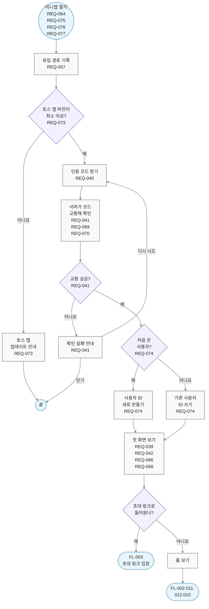

# FL-001 미니앱 진입과 사용자 식별

상태: 승인(DEC-015) · 누가: 모든 사용자(방장, 참여자, 처음 온 사람) · 관련 흐름: FL-002, FL-003, FL-007

목표: 토스 앱에서 미니앱을 열면 로그인 없이 사용자를 확인하고 첫 화면을 봐요.

Serves: REQ-039, REQ-040, REQ-041, REQ-042, REQ-057, REQ-064, REQ-066, REQ-068, REQ-069, REQ-070, REQ-073, REQ-074, REQ-075, REQ-076, REQ-077

| 모양 | 뜻 |
| --- | --- |
| 둥근 끝 상자 | 흐름의 시작이나 끝, 또는 이어지는 다른 흐름(FL ID) |
| 사각형 | 한 단계 |
| 마름모 | 결정. 가지마다 이름이 있어요 |
| 회색 선 | 다음 단계로 넘어감(저장소를 그리지 않아 쓰기·읽기 선은 없어요) |

그림 설명: 식별키를 클라이언트에서 받기만 하고, 사용자 확인은 서버가 인증 코드를 교환한 뒤에 해요.

## 단계

| 단계 | 종류 | 하는 일 | REQ |
| --- | --- | --- | --- |
| 미니앱 열기 | 시작·끝 | 토스 앱 안 WebView로 미니앱을 열어요. SDK 3.x, CSR/SSG 화면, iframe 없음, 라이트 모드만이에요. | REQ-064, REQ-075, REQ-076, REQ-077 |
| 유입 경로 기록 | 단계 | `referrer`가 `external_share`인지 남겨요(공유율, 자연 유입 집계). | REQ-057 |
| 토스 앱 버전이 최소 이상? | 결정 | 사용자 식별키 최소 버전 5.232.0을 봐요. 공유 OG 이미지 최소 버전은 FL-007에서 같은 안내를 써요. | REQ-073 |
| 토스 앱 업데이트 안내 | 단계 | 업데이트해야 쓸 수 있다고 알리고 더 진행하지 않아요. | REQ-073 |
| 인증 코드 받기 | 단계 | SDK로 사용자 식별키 인증 코드를 받아요. 식별키 원문은 클라이언트가 서버에 보내지 않아요. | REQ-040 |
| 서버가 코드 교환해 확인 | 단계 | 서버가 토스 파트너 API(mTLS)로 코드를 교환해요. 허용된 두 Origin의 요청만 받고, 토스 API 호출 한도를 지켜요. | REQ-041, REQ-069, REQ-070 |
| 교환 성공? | 결정 | 코드가 만료·재사용·위조됐거나 토스 API가 실패하면 실패예요. | REQ-041 |
| 확인 실패 안내 | 단계 | 사용자 확인이 안 됐다고 알리고 [다시 시도]와 [닫기]를 줘요. 확인 전에는 어떤 데이터도 읽거나 쓰지 않아요. | REQ-041 |
| 처음 온 사용자? | 결정 | 식별키 해시로 사용자 ID를 찾아요. | REQ-074 |
| 사용자 ID 새로 만들기 | 단계 | 식별키 원문이 아니라 해시와 내부 사용자 ID만 저장해요(사용자 등록됨). | REQ-074 |
| 기존 사용자 ID 쓰기 | 단계 | 찾은 사용자 ID로 이어서 요청을 처리해요. | REQ-074 |
| 첫 화면 보기 | 단계 | 회원가입·실명·연락처를 묻지 않고, 바텀시트를 자동으로 띄우지 않아요. 첫 의미 있는 화면은 P95 10초 안이에요. | REQ-039, REQ-042, REQ-066, REQ-068 |
| 초대 링크로 들어왔나? | 결정 | 진입 경로에 방 코드가 있는지 봐요. | — |
| 홈 보기 | 단계 | 방 만들기, 지난 카드, 메뉴(내 데이터 지우기, 약관)를 보여 줘요. | — |

## 실패 경로

- 토스 앱이 낮은 버전 → 업데이트 안내에서 멈춰요(REQ-073).
- 인증 코드 교환 실패(코드 만료·재사용, 토스 API 오류, 호출 한도) → 데이터를 읽거나 쓰지 않고 다시 시도를 줘요(REQ-041, REQ-069).
- 허용되지 않은 Origin에서 온 요청 → 서버가 거절해요(REQ-070).
