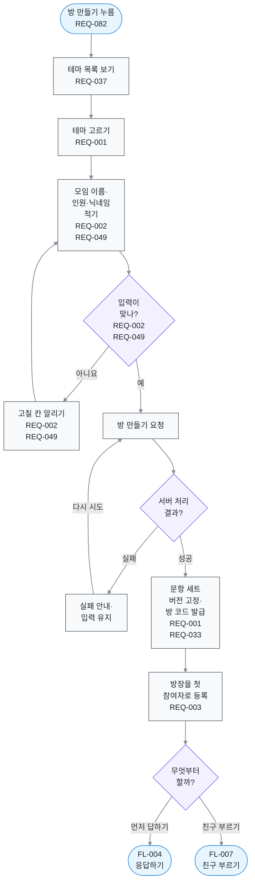

# FL-002 방 만들기

상태: 초안(03 체크포인트 대기) · 누가: 방장 · 관련 흐름: FL-004, FL-007

목표: 테마를 골라 방을 만들고, 먼저 답하거나 친구를 불러요.

Serves: REQ-001, REQ-002, REQ-003, REQ-033, REQ-037, REQ-049, REQ-082

| 모양 | 뜻 |
| --- | --- |
| 둥근 끝 상자 | 흐름의 시작이나 끝, 또는 이어지는 다른 흐름(FL ID) |
| 사각형 | 한 단계 |
| 마름모 | 결정. 가지마다 이름이 있어요 |
| 회색 선 | 다음 단계로 넘어감(저장소를 그리지 않아 쓰기·읽기 선은 없어요) |

그림 설명: 방을 만드는 순간 테마의 최신 배포 버전이 방에 고정되고, 방장은 첫 참여자가 돼요.

## 단계

| 단계 | 종류 | 하는 일 | REQ |
| --- | --- | --- | --- |
| 방 만들기 누름 | 시작·끝 | 홈의 [방 만들기]나 공유된 최종 카드의 [우리도 해 보기]로 시작해요. | REQ-082 |
| 테마 목록 보기 | 단계 | 배포된 테마(여행, 회식·저녁, 주말 나들이)만 보여 줘요. | REQ-037 |
| 테마 고르기 | 단계 |  | REQ-001 |
| 모임 이름·인원·닉네임 적기 | 단계 | 모임 이름 1~20자, 인원 2~8명, 방장 닉네임 1~10자예요. | REQ-002, REQ-049 |
| 입력이 맞나? | 결정 | 빈 값, 길이, 인원 범위, 닉네임 금칙어를 봐요. | REQ-002, REQ-049 |
| 고칠 칸 알리기 | 단계 | 칸마다 이유를 알리고 적은 값은 그대로 둬요. | REQ-002, REQ-049 |
| 방 만들기 요청 | 단계 |  | — |
| 서버 처리 결과? | 결정 |  | — |
| 실패 안내·입력 유지 | 단계 | 연결 실패나 서버 오류면 적은 값을 지우지 않고 다시 시도를 줘요. 다시 보내도 방은 하나만 생겨요. | — |
| 문항 세트 버전 고정·방 코드 발급 | 단계 | 그 테마의 배포된 최신 버전을 방에 고정해요(방 생성됨). | REQ-001, REQ-033 |
| 방장을 첫 참여자로 등록 | 단계 |  | REQ-003 |
| 무엇부터 할까? | 결정 | 문항 화면을 먼저 보여 주고, 같은 화면에 [친구 부르기]를 둬요(DEC-005). | — |

## 실패 경로

- 입력이 범위 밖(인원 2~8 밖, 모임 이름 빈 값·20자 초과, 닉네임 규칙 위반) → 방을 만들지 않고 고칠 칸을 알려요(REQ-002, REQ-049).
- 연결·서버 실패 → 입력을 지키고 다시 시도. 같은 요청을 다시 보내도 방은 하나예요.
