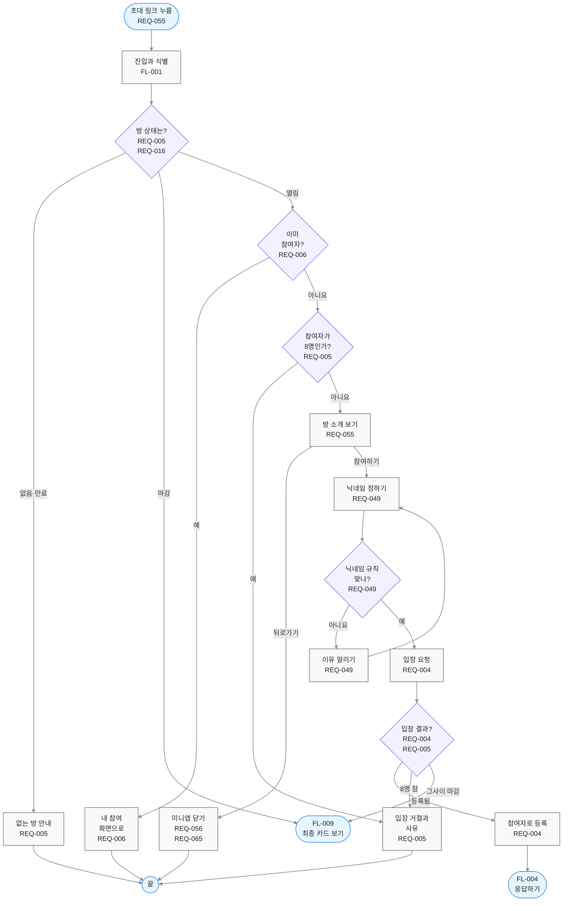

# FL-003 초대 링크로 입장

상태: 승인(DEC-015) · 누가: 초대 링크를 받은 사용자 · 관련 흐름: FL-001, FL-004, FL-009

목표: 단톡방의 초대 링크를 눌러 방 소개를 보고 닉네임을 정해 입장해요.

Serves: REQ-004, REQ-005, REQ-006, REQ-016, REQ-049, REQ-055, REQ-056, REQ-065

| 모양 | 뜻 |
| --- | --- |
| 둥근 끝 상자 | 흐름의 시작이나 끝, 또는 이어지는 다른 흐름(FL ID) |
| 사각형 | 한 단계 |
| 마름모 | 결정. 가지마다 이름이 있어요 |
| 회색 선 | 다음 단계로 넘어감(저장소를 그리지 않아 쓰기·읽기 선은 없어요) |

그림 설명: 방 상태는 링크를 열 때 한 번, 입장 요청 때 한 번 더 봐요. 그 사이 마감되거나 8명이 찰 수 있어서예요.

## 단계

| 단계 | 종류 | 하는 일 | REQ | SCR |
| --- | --- | --- | --- | --- |
| 초대 링크 누름 | 시작·끝 | `intoss://` 초대 링크로 미니앱이 열려요. | REQ-055 | 토스(초대 링크) |
| 진입과 식별 FL-001 | 단계 | FL-001을 거쳐 사용자 ID를 확인해요. | — | SCR-001 |
| 방 상태는? | 결정 | 방 코드로 방을 찾아요. | REQ-005, REQ-016 | SCR-005 |
| 없는 방 안내 | 단계 | "이 방은 없거나 보관 기간이 지났어요"라고 알리고 [방 만들기]를 줘요. 만료된 방은 지워져 없는 방과 같아요. | REQ-005 | SCR-005#error |
| 이미 참여자? | 결정 | 사용자 ID로 그 방의 참여자인지 봐요. | REQ-006 | SCR-005 |
| 내 참여 화면으로 | 단계 | 새 참여자를 만들지 않고, 응답 전이면 문항 화면, 응답 뒤면 내 결과 화면을 보여 줘요. | REQ-006 | SCR-007, SCR-008 |
| 참여자가 8명인가? | 결정 |  | REQ-005 | SCR-005 |
| 입장 거절과 사유 | 단계 | "이 방은 8명이 다 찼어요"처럼 사유를 보여 줘요. | REQ-005 | SCR-005#full, SCR-006#error |
| 방 소개 보기 | 단계 | 모임 이름·테마·인원·응답 완료 수·상태와 "인원이 다 답하면 마감돼요"를 보여 줘요. | REQ-055 | SCR-005 |
| 미니앱 닫기 | 단계 | 첫 화면에서 토스 내비게이션 바의 뒤로가기를 누르면 닫혀요. | REQ-056, REQ-065 | SCR-005(토스 내비게이션 바) |
| 닉네임 정하기 | 단계 |  | REQ-049 | SCR-006 |
| 닉네임 규칙 맞나? | 결정 | 1~10자, 금칙어 목록에 든 말 없음. | REQ-049 | SCR-006 |
| 이유 알리기 | 단계 |  | REQ-049 | SCR-006#error |
| 입장 요청 | 단계 |  | REQ-004 | SCR-006#loading |
| 입장 결과? | 결정 | 서버가 상태를 다시 봐요. | REQ-004, REQ-005 | SCR-006 |
| 참여자로 등록 | 단계 | 참여자 입장함. 같은 요청이 두 번 와도 참여자는 하나예요. | REQ-004 | 서버 |

## 실패 경로

- 방이 없거나 만료됨 → 사유를 보여 주고 입장하지 않아요(REQ-005).
- 8명이 참 → 입장 거절과 사유(REQ-005). 입장 요청 때 다시 확인해요.
- 마감된 방 → 입장하지 않고 FL-009에서 최종 카드를 읽기 전용으로 봐요(REQ-016).
- 이미 참여자 → 새 참여자를 만들지 않아요(REQ-006).
- 닉네임 규칙 위반 → 받지 않고 이유를 알려요(REQ-049).
- 첫 화면에서 뒤로가기 → 미니앱을 닫아요(REQ-056).
