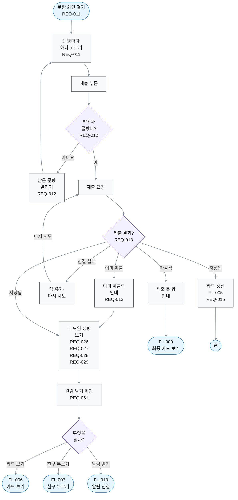

# FL-004 응답하고 내 모임 성향 받기

상태: 초안(03 체크포인트 대기) · 누가: 참여자(방장 포함) · 관련 흐름: FL-005, FL-006, FL-007, FL-009, FL-010

목표: 문항 8개에 답해 제출하고, 다른 사람을 기다리지 않고 내 모임 성향을 받아요.

Serves: REQ-011, REQ-012, REQ-013, REQ-015, REQ-026, REQ-027, REQ-028, REQ-029, REQ-061

| 모양 | 뜻 |
| --- | --- |
| 둥근 끝 상자 | 흐름의 시작이나 끝, 또는 이어지는 다른 흐름(FL ID) |
| 사각형 | 한 단계 |
| 마름모 | 결정. 가지마다 이름이 있어요 |
| 회색 선 | 다음 단계로 넘어감(저장소를 그리지 않아 쓰기·읽기 선은 없어요) |

그림 설명: 제출이 저장되면 내 모임 성향 보기와 카드 갱신(FL-005)이 따로 일어나요.

## 단계

| 단계 | 종류 | 하는 일 | REQ |
| --- | --- | --- | --- |
| 문항 화면 열기 | 시작·끝 | 방에 고정된 문항 세트 버전의 문항 8개를 보여 줘요. | REQ-011 |
| 문항마다 하나 고르기 | 단계 | 선택지 A, 선택지 B, "상관없어요" 중 하나만 골라요. | REQ-011 |
| 제출 누름 | 단계 |  | — |
| 8개 다 골랐나? | 결정 |  | REQ-012 |
| 남은 문항 알리기 | 단계 | 제출하지 않고 남은 문항으로 데려가요. | REQ-012 |
| 제출 요청 | 단계 |  | — |
| 제출 결과? | 결정 |  | REQ-013 |
| 이미 제출함 안내 | 단계 | 응답을 바꾸지 않고 저장된 응답의 결과를 보여 줘요. | REQ-013 |
| 답 유지·다시 시도 | 단계 | 연결 실패면 고른 답을 지우지 않아요. 다시 보내도 응답은 하나예요. | — |
| 제출 못 함 안내 | 단계 | "방이 그사이 마감됐어요"라고 알려요. | — |
| 카드 갱신 FL-005 | 단계 | 서버 정책으로 따로 일어나요. | REQ-015 |
| 내 모임 성향 보기 | 단계 | 한 줄 설명과 3개 축의 낮음·균형·높음. 저장하지 않고 응답에서 계산해요. | REQ-026, REQ-027, REQ-028, REQ-029 |
| 알림 받기 제안 | 단계 | 제출한 뒤에만 [알림 받기]를 보여 줘요. 자동 바텀시트가 아니에요. | REQ-061 |
| 무엇을 할까? | 결정 |  | — |

## 실패 경로

- 답하지 않은 문항이 있음 → 제출하지 않고 남은 문항을 알려요(REQ-012).
- 이미 제출함 → 응답을 바꾸지 않아요(REQ-013).
- 그사이 방이 마감됨(인원보다 많이 입장한 경우 등) → 제출하지 않고 최종 카드로 보내요(REQ-016, 02 4.3 빈틈).
- 연결 실패 → 답을 지키고 다시 시도. 응답은 하나만 저장돼요.
