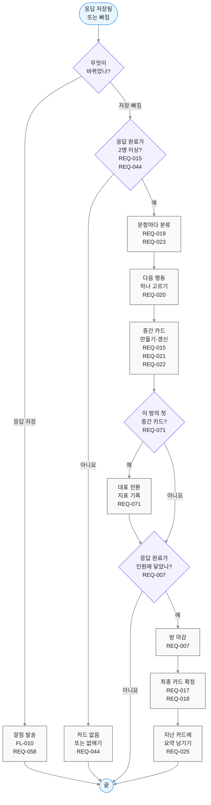

# FL-005 합의 카드 갱신과 자동 마감

상태: 초안(03 체크포인트 대기) · 누가: 서버(정책) · 관련 흐름: FL-004, FL-010, FL-012

목표: 응답이 저장되거나 빠지면 카드를 다시 계산하고, 인원이 다 답하면 방을 마감해요.

Serves: REQ-007, REQ-015, REQ-017, REQ-018, REQ-019, REQ-020, REQ-021, REQ-022, REQ-023, REQ-025, REQ-044, REQ-058, REQ-071

| 모양 | 뜻 |
| --- | --- |
| 둥근 끝 상자 | 흐름의 시작이나 끝, 또는 이어지는 다른 흐름(FL ID) |
| 사각형 | 한 단계 |
| 마름모 | 결정. 가지마다 이름이 있어요 |
| 회색 선 | 다음 단계로 넘어감(저장소를 그리지 않아 쓰기·읽기 선은 없어요) |

그림 설명: 카드 계산은 같은 입력이면 같은 결과인 순수 함수이고, 마감 때 한 번 확정한 최종 카드는 다시 계산하지 않아요.

## 단계

| 단계 | 종류 | 하는 일 | REQ |
| --- | --- | --- | --- |
| 응답 저장됨 또는 빠짐 | 시작·끝 | FL-004의 제출 또는 FL-012의 내 데이터 지우기에서 와요. | — |
| 무엇이 바뀌었나? | 결정 |  | — |
| 알림 발송 FL-010 | 단계 | 응답이 저장된 경우에만 신청자에게 알려요. | REQ-058 |
| 응답 완료가 2명 이상? | 결정 |  | REQ-015, REQ-044 |
| 카드 없음 또는 없애기 | 단계 | 응답이 빠져 2명 미만이 되면 중간 카드를 없애요. | REQ-044 |
| 문항마다 분류 | 단계 | 조율해요·모두 좋아요·누구나 괜찮아요. 응답 순서와 상관없이 같은 결과예요. | REQ-019, REQ-023 |
| 다음 행동 하나 고르기 | 단계 |  | REQ-020 |
| 중간 카드 만들기·갱신 | 단계 | 선택지별 수만 담고 닉네임·점수는 담지 않아요. | REQ-015, REQ-021, REQ-022 |
| 이 방의 첫 중간 카드? | 결정 |  | REQ-071 |
| 대표 전환 지표 기록 | 단계 | 방마다 한 번만 기록해요. 기록 방법은 F-2. | REQ-071 |
| 응답 완료가 인원에 닿았나? | 결정 |  | REQ-007 |
| 방 마감 | 단계 | 방 마감됨. | REQ-007 |
| 최종 카드 확정 | 단계 | 그때의 응답 완료로 확정하고 다시 바꾸지 않아요. | REQ-017, REQ-018 |
| 지난 카드에 요약 남기기 | 단계 | 응답한 참여자마다 이름 없는 요약을 남겨요. | REQ-025 |

## 실패 경로

- 응답 완료 2명 미만 → 카드가 없어요. 응답이 빠져 2명 미만이 되면 중간 카드를 없애요(REQ-015, REQ-044).
- 같은 순간 두 응답이 들어와 인원에 닿음 → 마감과 확정은 한 번만 일어나요(04 SPEC-016).
- 전환 지표 기록 실패 → 카드와 마감에는 영향이 없어요(REQ-071).
