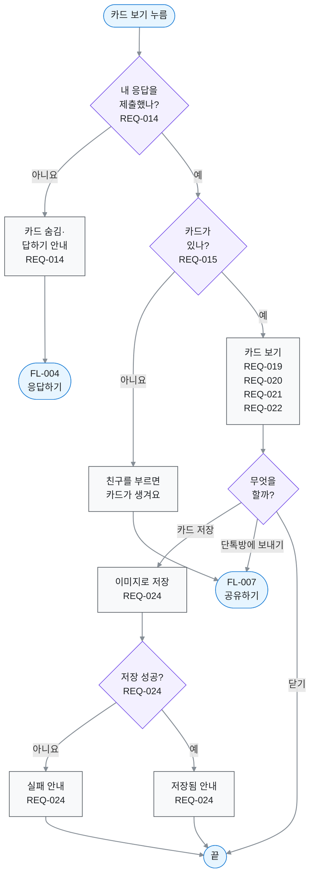

# FL-006 합의 카드 보기·저장·공유

상태: 승인(DEC-015) · 누가: 응답을 제출한 참여자 · 관련 흐름: FL-004, FL-007, FL-009

목표: 중간 카드나 최종 카드를 보고, 이미지로 저장하거나 단톡방에 보내요.

Serves: REQ-014, REQ-015, REQ-019, REQ-020, REQ-021, REQ-022, REQ-024

| 모양 | 뜻 |
| --- | --- |
| 둥근 끝 상자 | 흐름의 시작이나 끝, 또는 이어지는 다른 흐름(FL ID) |
| 사각형 | 한 단계 |
| 마름모 | 결정. 가지마다 이름이 있어요 |
| 회색 선 | 다음 단계로 넘어감(저장소를 그리지 않아 쓰기·읽기 선은 없어요) |

그림 설명: 자기 응답을 내기 전에는 열린 방의 카드를 볼 수 없어요(REQ-014).

## 단계

| 단계 | 종류 | 하는 일 | REQ |
| --- | --- | --- | --- |
| 내 응답을 제출했나? | 결정 | 열린 방 기준이에요. 마감된 방은 FL-009예요. | REQ-014 |
| 카드 숨김·답하기 안내 | 단계 | 다른 사람의 응답과 카드를 보여 주지 않아요. | REQ-014 |
| 카드가 있나? | 결정 |  | REQ-015 |
| 친구를 부르면 카드가 생겨요 | 단계 | 응답 완료가 1명일 때예요. | — |
| 카드 보기 | 단계 | 분류별 수와 문구, 다음 행동 하나. 중간이면 "n명 중 m명 기준"을 적어요. | REQ-019, REQ-020, REQ-021, REQ-022 |
| 무엇을 할까? | 결정 |  | — |
| 이미지로 저장 | 단계 |  | REQ-024 |
| 저장 성공? | 결정 |  | REQ-024 |
| 실패 안내 | 단계 | 권한 거절이나 오류를 알리고 다시 시도를 줘요. | REQ-024 |
| 저장됨 안내 | 단계 |  | REQ-024 |

## 실패 경로

- 자기 응답 전 → 카드를 보여 주지 않아요(REQ-014).
- 응답 완료 1명 → 카드 없음, 친구 부르기로 안내해요.
- 이미지 저장 실패(권한 거절, 저장 오류, 낮은 토스 앱 버전) → 실패를 알리고 다시 시도를 줘요(REQ-024).
