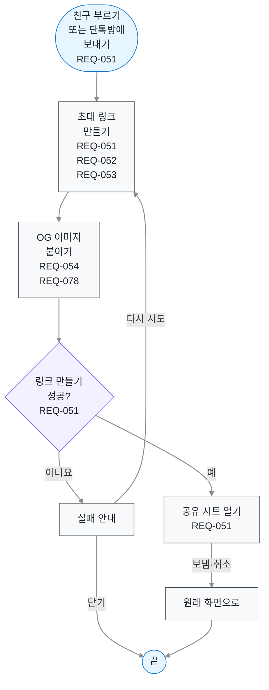

# FL-007 친구 부르기와 단톡방에 보내기

상태: 승인(DEC-015) · 누가: 참여자(방장 포함) · 관련 흐름: 없음

목표: 방 코드만 담은 초대 링크를 토스 공유 시트로 보내요.

Serves: REQ-051, REQ-052, REQ-053, REQ-054, REQ-078

| 모양 | 뜻 |
| --- | --- |
| 둥근 끝 상자 | 흐름의 시작이나 끝, 또는 이어지는 다른 흐름(FL ID) |
| 사각형 | 한 단계 |
| 마름모 | 결정. 가지마다 이름이 있어요 |
| 회색 선 | 다음 단계로 넘어감(저장소를 그리지 않아 쓰기·읽기 선은 없어요) |

그림 설명: 링크에는 방 코드 하나만 들어가고, 마감된 방의 링크는 최종 카드로 이어져요(FL-009).

## 단계

| 단계 | 종류 | 하는 일 | REQ | SCR |
| --- | --- | --- | --- | --- |
| 친구 부르기 또는 단톡방에 보내기 | 시작·끝 |  | REQ-051 | SCR-007, SCR-008, SCR-009, SCR-010 |
| 초대 링크 만들기 | 단계 | `intoss://` 링크에 방 코드만 넣어요. `intoss-private://`이나 자사 웹사이트로 보내지 않아요. | REQ-051, REQ-052, REQ-053 | SCR-007, SCR-008, SCR-009, SCR-010 |
| OG 이미지 붙이기 | 단계 | 1200×600px, `https://` 절대 경로, 점검을 통과한 이미지예요. | REQ-054, REQ-078 | SCR-007, SCR-008, SCR-009, SCR-010 |
| 링크 만들기 성공? | 결정 |  | REQ-051 | SCR-007, SCR-008, SCR-009, SCR-010 |
| 실패 안내 | 단계 | 다시 시도를 줘요. | — | SCR-007#error, SCR-008#error, SCR-009#error, SCR-010#error |
| 공유 시트 열기 | 단계 |  | REQ-051 | 토스(공유 시트) |
| 원래 화면으로 | 단계 | 보냈든 취소했든 원래 화면으로 돌아가요. | — | SCR-007, SCR-008, SCR-009, SCR-010 |

## 실패 경로

- 링크 만들기 실패 → 알리고 다시 시도(REQ-051).
- 공유 시트에서 취소 → 아무것도 바꾸지 않고 원래 화면으로.
