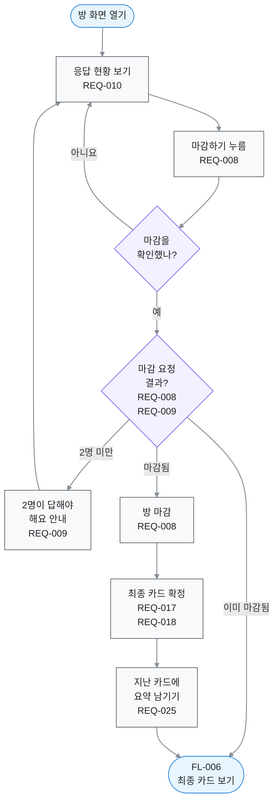

# FL-008 방장이 일찍 마감하기

상태: 초안(03 체크포인트 대기) · 누가: 방장 · 관련 흐름: FL-006

목표: 답이 늦을 때 응답 완료가 2명 이상이면 방을 마감하고 최종 카드를 받아요.

Serves: REQ-008, REQ-009, REQ-010, REQ-017, REQ-018, REQ-025

| 모양 | 뜻 |
| --- | --- |
| 둥근 끝 상자 | 흐름의 시작이나 끝, 또는 이어지는 다른 흐름(FL ID) |
| 사각형 | 한 단계 |
| 마름모 | 결정. 가지마다 이름이 있어요 |
| 회색 선 | 다음 단계로 넘어감(저장소를 그리지 않아 쓰기·읽기 선은 없어요) |

그림 설명: 마감은 되돌릴 수 없어 한 번 더 묻고, 서버는 요청 때의 응답 완료 수로 판단해요.

## 단계

| 단계 | 종류 | 하는 일 | REQ |
| --- | --- | --- | --- |
| 응답 현황 보기 | 단계 | "인원 4명 중 3명 답했어요". 누가 답했는지는 보여 주지 않아요. | REQ-010 |
| 마감하기 누름 | 단계 |  | REQ-008 |
| 마감을 확인했나? | 결정 | "마감하면 더 답할 수 없어요"를 묻는 확인 창이에요. | — |
| 마감 요청 결과? | 결정 |  | REQ-008, REQ-009 |
| 2명이 답해야 해요 안내 | 단계 | 마감하지 않아요. | REQ-009 |
| 방 마감 | 단계 |  | REQ-008 |
| 최종 카드 확정 | 단계 |  | REQ-017, REQ-018 |
| 지난 카드에 요약 남기기 | 단계 |  | REQ-025 |

## 실패 경로

- 응답 완료 2명 미만 → 마감하지 않고 알려요(REQ-009).
- 그사이 자동 마감됨 → 이미 마감된 최종 카드를 보여 줘요(마감은 한 번).
- 방장이 아닌 참여자 → [마감하기]가 보이지 않고, 요청해도 서버가 거절해요(REQ-008).
