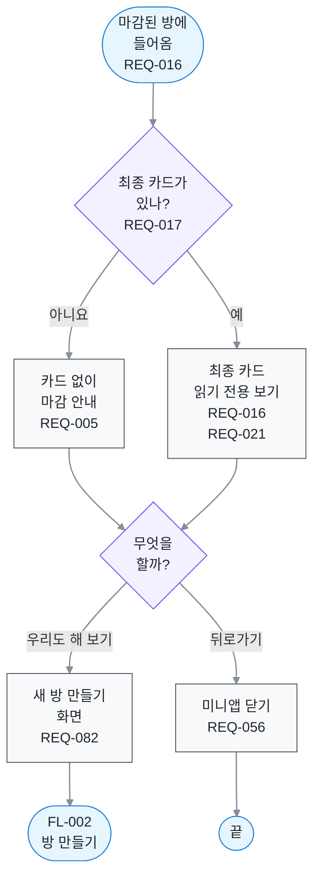

# FL-009 마감된 방의 최종 카드 보기

상태: 승인(DEC-015) · 누가: 마감된 방의 초대 링크로 들어온 누구나 · 관련 흐름: FL-002, FL-003, FL-004

목표: 응답 여부와 상관없이 최종 카드를 읽기 전용으로 보고, 우리 모임 방을 만들 수 있어요.

Serves: REQ-005, REQ-016, REQ-017, REQ-021, REQ-056, REQ-082

| 모양 | 뜻 |
| --- | --- |
| 둥근 끝 상자 | 흐름의 시작이나 끝, 또는 이어지는 다른 흐름(FL ID) |
| 사각형 | 한 단계 |
| 마름모 | 결정. 가지마다 이름이 있어요 |
| 회색 선 | 다음 단계로 넘어감(저장소를 그리지 않아 쓰기·읽기 선은 없어요) |

그림 설명: 마감 뒤에는 응답하지 않은 사람과 처음 온 사람도 최종 카드를 봐요(DEC-013).

## 단계

| 단계 | 종류 | 하는 일 | REQ | SCR |
| --- | --- | --- | --- | --- |
| 마감된 방에 들어옴 | 시작·끝 | FL-003이나 FL-004에서 와요. | REQ-016 | SCR-010 |
| 최종 카드가 있나? | 결정 | 응답 완료 2명 미만으로 마감된 방은 카드가 없어요. | REQ-017 | SCR-010 |
| 카드 없이 마감 안내 | 단계 | "답한 사람이 적어 카드 없이 마감됐어요". | REQ-005 | SCR-010#empty |
| 최종 카드 읽기 전용 보기 | 단계 | 이름 없는 수와 문구, 다음 행동만 보여 줘요. | REQ-016, REQ-021 | SCR-010 |
| 무엇을 할까? | 결정 |  | — | SCR-010 |
| 새 방 만들기 화면 | 단계 | [우리도 해 보기]. | REQ-082 | SCR-003 |
| 미니앱 닫기 | 단계 | 첫 화면에서 뒤로가기. | REQ-056 | SCR-010(토스 내비게이션 바) |

## 실패 경로

- 카드 없이 마감된 방 → 사유를 보여 주고 [우리도 해 보기]를 줘요.
- 만료된 방 → FL-003의 없는 방 안내예요.
