# FL-010 기능성 알림 신청과 받기

상태: 승인(DEC-015), DEC-019로 식별키 단계 고침 · 누가: 응답을 제출한 참여자, 서버 · 관련 흐름: FL-004, FL-005

목표: 신청한 참여자만 같은 방의 다른 사람이 답을 마쳤을 때 알림을 받아요.

Serves: REQ-043, REQ-047, REQ-058, REQ-059, REQ-060, REQ-061, REQ-069, REQ-074, REQ-084

```mermaid
---
config:
  flowchart:
    wrappingWidth: 240
---
flowchart TD
  subgraph L1["① 신청 (참여자)"]
    A(["알림 받기 누름<br/>REQ-061"])
    B["토스 알림<br/>동의 화면<br/>REQ-058"]
    C{"동의했나?<br/>REQ-058"}
    D1["신청 없이<br/>그대로 두기"]
    E["알림 신청 저장<br/>REQ-058<br/>REQ-074"]
    Z1(["끝"])
  end
  subgraph L2["② 발송 (서버)"]
    F1(["다른 사람의<br/>응답 저장됨<br/>REQ-058"])
    G{"본인 말고<br/>신청자가 있나?<br/>REQ-058"}
    H["템플릿 문구로<br/>발송<br/>REQ-059<br/>REQ-060<br/>REQ-069"]
    I{"발송 성공?"}
    J["실패 기록만<br/>남기기"]
    Z2(["끝"])
  end
  subgraph L3["③ 정리 (서버)"]
    K(["방 마감·만료<br/>또는 지우기<br/>REQ-043<br/>REQ-047<br/>REQ-084"])
    L["알림 신청과<br/>식별키 지우기<br/>REQ-074<br/>REQ-084"]
    Z3(["끝"])
  end
  A e1@--> B
  B e2@--> C
  C e3@-->|아니요| D1
  D1 e4@--> Z1
  C e5@-->|예| E
  E e6@--> Z1
  F1 e7@--> G
  G e8@-->|아니요| Z2
  G e9@-->|예| H
  H e10@--> I
  I e11@-->|아니요| J
  J e12@--> Z2
  I e13@-->|예| Z2
  K e14@--> L
  L e15@--> Z3
  %% legend: below
  classDef term fill:#e7f5ff,stroke:#1c7ed6,color:#212529
  classDef proc fill:#f8f9fa,stroke:#495057,color:#212529
  classDef decide fill:#f3f0ff,stroke:#7048e8,color:#212529
  classDef pass stroke:#868e96,stroke-width:1.5px
  class A,Z1,F1,Z2,K,Z3 term
  class B,D1,E,H,J,L proc
  class C,G,I decide
  class e1,e2,e3,e4,e5,e6,e7,e8,e9,e10,e11,e12,e13,e14,e15 pass
```

| 모양 | 뜻 |
| --- | --- |
| 둥근 끝 상자 | 흐름의 시작이나 끝, 또는 이어지는 다른 흐름(FL ID) |
| 사각형 | 한 단계 |
| 마름모 | 결정. 가지마다 이름이 있어요 |
| 회색 선 | 다음 단계로 넘어감(저장소를 그리지 않아 쓰기·읽기 선은 없어요) |

그림 설명: 신청은 제출 뒤 사용자가 누를 때만 묻고, 발송은 신청자 본인이 아닌 다른 사람의 응답에만 해요.

## 단계

| 단계 | 종류 | 하는 일 | REQ | SCR |
| --- | --- | --- | --- | --- |
| 알림 받기 누름 | 시작·끝 | FL-004의 내 결과 화면에서 와요. | REQ-061 | SCR-008 |
| 토스 알림 동의 화면 | 단계 | 토스가 주는 동의문을 띄워요. | REQ-058 | 토스(알림 동의문) |
| 동의했나? | 결정 |  | REQ-058 | SCR-008 |
| 신청 없이 그대로 두기 | 단계 |  | — | SCR-008 |
| 알림 신청 저장 | 단계 | 그 방, 그 사용자 하나에 신청 하나예요. 발송용 식별키를 암호화해 함께 저장해요(DEC-019). | REQ-058, REQ-074 | SCR-008#notify-done |
| 다른 사람의 응답 저장됨 | 시작·끝 | FL-005에서 와요. | REQ-058 | 서버 |
| 본인 말고 신청자가 있나? | 결정 |  | REQ-058 | 서버 |
| 템플릿 문구로 발송 | 단계 | 검수받은 문구만, 제목 7자·본문 25자 안. 호출 한도를 지켜요. | REQ-059, REQ-060, REQ-069 | 서버(토스 알림으로 받음) |
| 발송 성공? | 결정 |  | — | 서버 |
| 실패 기록만 남기기 | 단계 | 다시 보내지 않아요. 응답·카드에는 영향이 없어요. | — | 서버 |
| 방 마감·만료 또는 지우기 | 시작·끝 |  | REQ-043, REQ-047, REQ-084 | 서버 |
| 알림 신청과 식별키 지우기 | 단계 | 더 보낼 일이 없으므로 신청과 암호화해 둔 식별키를 바로 지워요(알림 신청 삭제됨). | REQ-074, REQ-084 | 서버 |

## 실패 경로

- 동의하지 않음 → 신청하지 않아요.
- 발송 실패(토스 API 오류, 한도) → 기록만 남기고 다시 보내지 않아요(REQ-069).
- 광고성·리텐션 문구 → 템플릿에 넣지 않아요(REQ-059).
