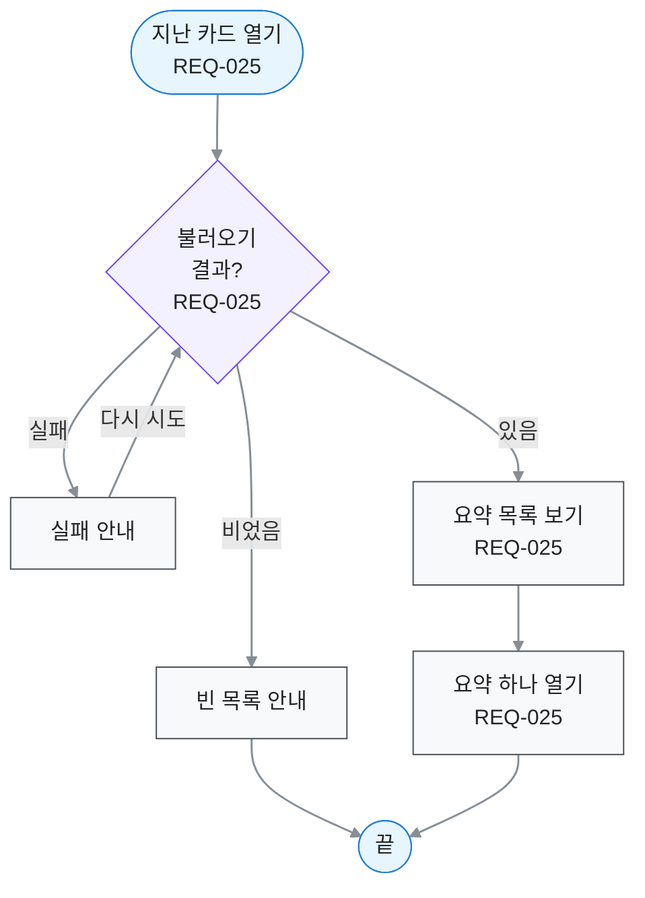

# FL-011 지난 카드 보기

상태: 승인(DEC-015) · 누가: 참여자 · 관련 흐름: 없음

목표: 내가 참여한 방의 최종 카드 요약을 다시 봐요.

Serves: REQ-025

| 모양 | 뜻 |
| --- | --- |
| 둥근 끝 상자 | 흐름의 시작이나 끝, 또는 이어지는 다른 흐름(FL ID) |
| 사각형 | 한 단계 |
| 마름모 | 결정. 가지마다 이름이 있어요 |
| 회색 선 | 다음 단계로 넘어감(저장소를 그리지 않아 쓰기·읽기 선은 없어요) |

그림 설명: 지난 카드 요약에는 닉네임이 없고, 방이 만료돼도 남아요(DEC-009).

## 단계

| 단계 | 종류 | 하는 일 | REQ |
| --- | --- | --- | --- |
| 지난 카드 열기 | 시작·끝 | 홈에서 열어요. | REQ-025 |
| 불러오기 결과? | 결정 |  | REQ-025 |
| 실패 안내 | 단계 | 다시 시도를 줘요. | — |
| 빈 목록 안내 | 단계 | "아직 지난 카드가 없어요"와 [방 만들기]. | — |
| 요약 목록 보기 | 단계 | 모임 이름, 테마, 분류별 수와 문구, 다음 행동. | REQ-025 |
| 요약 하나 열기 | 단계 |  | REQ-025 |

## 실패 경로

- 불러오기 실패 → 다시 시도.
- 목록이 비었음 → 빈 목록 안내.
