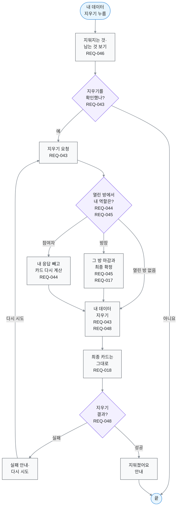

# FL-012 내 데이터 지우기

상태: 승인(DEC-015), DEC-029로 "지워졌어요 안내" 고침 · 누가: 사용자 · 관련 흐름: FL-005

목표: 지워지는 것과 남는 것을 보고 확인하면 내 데이터를 지워요.

Serves: REQ-017, REQ-018, REQ-043, REQ-044, REQ-045, REQ-046, REQ-048

| 모양 | 뜻 |
| --- | --- |
| 둥근 끝 상자 | 흐름의 시작이나 끝, 또는 이어지는 다른 흐름(FL ID) |
| 사각형 | 한 단계 |
| 마름모 | 결정. 가지마다 이름이 있어요 |
| 회색 선 | 다음 단계로 넘어감(저장소를 그리지 않아 쓰기·읽기 선은 없어요) |

그림 설명: 열린 방에서는 내 응답을 빼고 카드를 다시 계산하고, 내가 방장인 열린 방은 마감해요. 확정된 최종 카드는 그대로예요.

## 단계

| 단계 | 종류 | 하는 일 | REQ | SCR |
| --- | --- | --- | --- | --- |
| 내 데이터 지우기 누름 | 시작·끝 | 메뉴에서 열어요. | — | SCR-002 |
| 지워지는 것·남는 것 보기 | 단계 | 남는 것: 확정된 최종 카드의 이름 없는 수. | REQ-046 | SCR-013 |
| 지우기를 확인했나? | 결정 |  | REQ-043 | SCR-013#confirm |
| 지우기 요청 | 단계 |  | REQ-043 | SCR-013#loading |
| 열린 방에서 내 역할은? | 결정 | 열린 방마다 봐요. | REQ-044, REQ-045 | 서버 |
| 그 방 마감과 최종 확정 | 단계 | 방장 응답을 빼고 확정, 2명 미만이면 카드 없이 마감. | REQ-045, REQ-017 | 서버 |
| 내 응답 빼고 카드 다시 계산 | 단계 | FL-005로 이어져요. | REQ-044 | 서버 |
| 내 데이터 지우기 | 단계 | 응답, 닉네임, 알림 신청, 지난 카드 목록, 사용자 ID. 1분 안. | REQ-043, REQ-048 | 서버 |
| 최종 카드는 그대로 | 단계 |  | REQ-018 | 서버 |
| 지우기 결과? | 결정 |  | REQ-048 | SCR-013 |
| 실패 안내·다시 시도 | 단계 | 아무것도 지우지 않은 상태로 돌아가요. | — | SCR-013#error |
| 지워졌어요 안내 | 단계 | 처음 화면으로 자동으로 가지 않고 [미니앱 닫기]와 [처음 화면으로] 중 고르게 해요. [처음 화면으로]를 누를 때만 사용자 확인을 해요. 다시 쓰면 새 사용자로 시작해요(DEC-029). | — | SCR-013#done |

## 실패 경로

- 확인하지 않음 → 아무것도 지우지 않아요(REQ-046).
- 지우기 실패 → 하나도 지우지 않은 상태로 두고 다시 시도(REQ-048).
- 방장인 열린 방 → 그 방을 마감(REQ-045).
