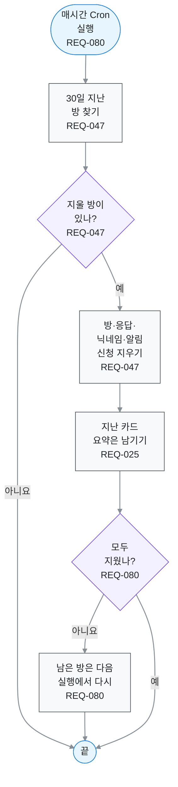

# FL-013 방 만료

상태: 승인(DEC-015) · 누가: 스케줄러(Cloudflare Cron Trigger) · 관련 흐름: 없음

목표: 만든 지 30일이 지난 방과 그 응답을 24시간 안에 지워요.

Serves: REQ-025, REQ-047, REQ-080

| 모양 | 뜻 |
| --- | --- |
| 둥근 끝 상자 | 흐름의 시작이나 끝, 또는 이어지는 다른 흐름(FL ID) |
| 사각형 | 한 단계 |
| 마름모 | 결정. 가지마다 이름이 있어요 |
| 회색 선 | 다음 단계로 넘어감(저장소를 그리지 않아 쓰기·읽기 선은 없어요) |

그림 설명: 만료는 매시간 돌아, 한 번 실패해도 24시간 안에 다시 지울 기회가 있어요.

## 단계

| 단계 | 종류 | 하는 일 | REQ |
| --- | --- | --- | --- |
| 매시간 Cron 실행 | 시작·끝 |  | REQ-080 |
| 30일 지난 방 찾기 | 단계 |  | REQ-047 |
| 지울 방이 있나? | 결정 |  | REQ-047 |
| 방·응답·닉네임·알림 신청 지우기 | 단계 | 방 만료됨. | REQ-047 |
| 지난 카드 요약은 남기기 | 단계 |  | REQ-025 |
| 모두 지웠나? | 결정 |  | REQ-080 |
| 남은 방은 다음 실행에서 다시 | 단계 |  | REQ-080 |

## 실패 경로

- 일부 삭제 실패 → 다음 실행에서 다시 지워요(REQ-080).
