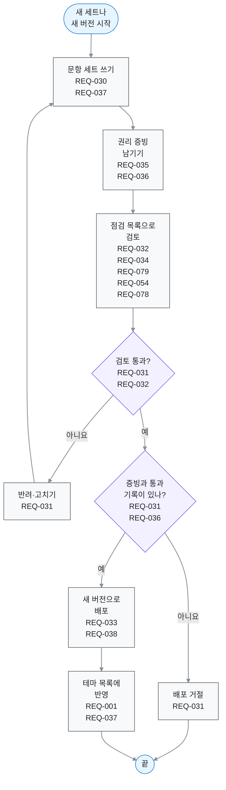

# FL-014 문항 세트 작성·검토·배포

상태: 초안(03 체크포인트 대기) · 누가: 운영자 · 관련 흐름: 없음

목표: 테마별 문항 세트를 쓰고 점검 목록으로 검토한 뒤 새 버전으로 배포해요.

Serves: REQ-001, REQ-030, REQ-031, REQ-032, REQ-033, REQ-034, REQ-035, REQ-036, REQ-037, REQ-038, REQ-054, REQ-078, REQ-079

| 모양 | 뜻 |
| --- | --- |
| 둥근 끝 상자 | 흐름의 시작이나 끝, 또는 이어지는 다른 흐름(FL ID) |
| 사각형 | 한 단계 |
| 마름모 | 결정. 가지마다 이름이 있어요 |
| 회색 선 | 다음 단계로 넘어감(저장소를 그리지 않아 쓰기·읽기 선은 없어요) |

그림 설명: 검토를 통과하고 권리 증빙이 있는 세트만 같은 미니앱 안의 새 버전으로 배포돼요.

## 단계

| 단계 | 종류 | 하는 일 | REQ |
| --- | --- | --- | --- |
| 문항 세트 쓰기 | 단계 | 테마 하나, 문항 8개, 문구 전체. | REQ-030, REQ-037 |
| 권리 증빙 남기기 | 단계 | 작성 역할·작성일·원본·라이선스·AI 생성 기록. 6결 콘텐츠는 쓰지 않아요. | REQ-035, REQ-036 |
| 점검 목록으로 검토 | 단계 | 금지 소재 10종, 정치 성향, 해요체, 금칙어, OG 이미지 크기·문구. | REQ-032, REQ-034, REQ-079, REQ-054, REQ-078 |
| 검토 통과? | 결정 |  | REQ-031, REQ-032 |
| 반려·고치기 | 단계 |  | REQ-031 |
| 증빙과 통과 기록이 있나? | 결정 | 배포 단계가 다시 봐요. | REQ-031, REQ-036 |
| 배포 거절 | 단계 |  | REQ-031 |
| 새 버전으로 배포 | 단계 | 배포된 버전은 고치지 않아요. 같은 미니앱 안의 새 세트예요. | REQ-033, REQ-038 |
| 테마 목록에 반영 | 단계 | 이미 만든 방은 고정된 버전을 계속 써요. | REQ-001, REQ-037 |

## 실패 경로

- 검토 반려 → 고쳐서 다시 검토(REQ-031).
- 검토 통과·증빙 기록 없이 배포 → 거절(REQ-031, REQ-036).
