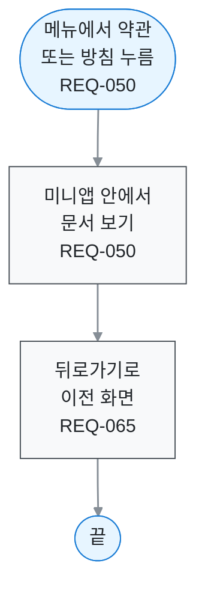

# FL-015 약관과 개인정보처리방침 보기

상태: 초안(03 체크포인트 대기) · 누가: 사용자 · 관련 흐름: 없음

목표: 미니앱 안에서 이용약관과 개인정보처리방침을 봐요.

Serves: REQ-050, REQ-065

| 모양 | 뜻 |
| --- | --- |
| 둥근 끝 상자 | 흐름의 시작이나 끝, 또는 이어지는 다른 흐름(FL ID) |
| 사각형 | 한 단계 |
| 마름모 | 결정. 가지마다 이름이 있어요 |
| 회색 선 | 다음 단계로 넘어감(저장소를 그리지 않아 쓰기·읽기 선은 없어요) |

그림 설명: 두 문서는 미니앱 안의 화면이라 따로 불러오다 실패할 일이 없어요.

## 단계

| 단계 | 종류 | 하는 일 | REQ |
| --- | --- | --- | --- |
| 메뉴에서 약관 또는 방침 누름 | 시작·끝 |  | REQ-050 |
| 미니앱 안에서 문서 보기 | 단계 | 저장 위치(해외 리전)와 보관 기간 30일을 적어요. | REQ-050 |
| 뒤로가기로 이전 화면 | 단계 | 토스 내비게이션 바의 뒤로가기만 써요. | REQ-065 |

## 실패 경로

- 없음(정적 화면).
