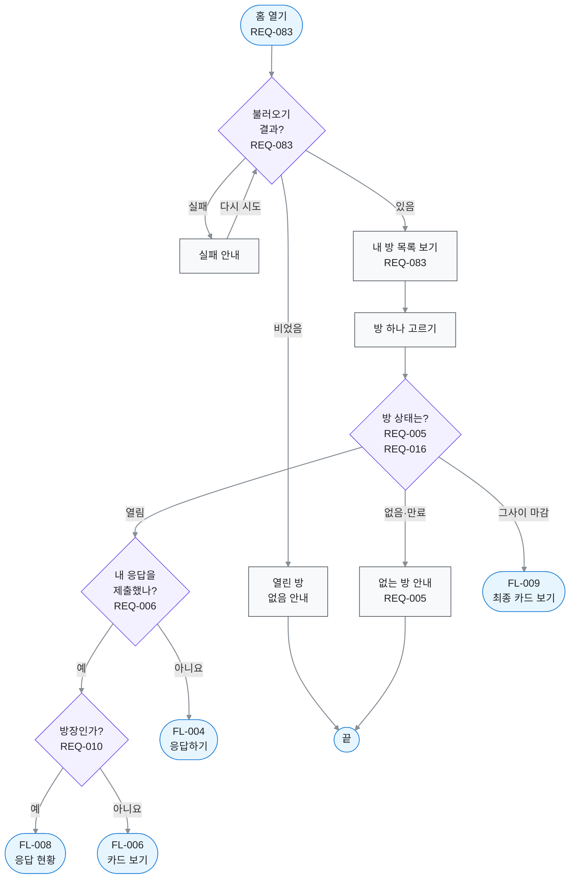

# FL-016 열린 방으로 돌아가기

상태: 승인(DEC-018) · 누가: 참여자(방장 포함) · 관련 흐름: FL-001, FL-004, FL-006, FL-008, FL-009

목표: 초대 링크 없이 홈의 내 방 목록에서 참여 중인 열린 방으로 돌아가요.

Serves: REQ-005, REQ-006, REQ-010, REQ-016, REQ-083

| 모양 | 뜻 |
| --- | --- |
| 둥근 끝 상자 | 흐름의 시작이나 끝, 또는 이어지는 다른 흐름(FL ID) |
| 사각형 | 한 단계 |
| 마름모 | 결정. 가지마다 이름이 있어요 |
| 회색 선 | 다음 단계로 넘어감(저장소를 그리지 않아 쓰기·읽기 선은 없어요) |

그림 설명: 방장이 초대 링크를 보내기 전에 미니앱을 닫아도 내 방 목록으로 방에 돌아올 수 있어요(DEC-018).

## 단계

| 단계 | 종류 | 하는 일 | REQ | SCR |
| --- | --- | --- | --- | --- |
| 홈 열기 | 시작·끝 | FL-001에서 와요. | REQ-083 | SCR-002 |
| 불러오기 결과? | 결정 |  | REQ-083 | SCR-002 |
| 실패 안내 | 단계 | 다시 시도를 줘요. | — | SCR-002#error |
| 열린 방 없음 안내 | 단계 | "참여 중인 방이 없어요"와 [방 만들기]. | — | SCR-002#empty |
| 내 방 목록 보기 | 단계 | 모임 이름, 테마, 응답 완료 수. 닉네임과 누가 답했는지는 없어요. | REQ-083 | SCR-002 |
| 방 하나 고르기 | 단계 |  | — | SCR-002 |
| 방 상태는? | 결정 | 목록을 본 뒤 상태가 바뀌었을 수 있어 다시 봐요. | REQ-005, REQ-016 | SCR-005 |
| 없는 방 안내 | 단계 | "이 방은 없거나 보관 기간이 지났어요". | REQ-005 | SCR-005#error |
| 내 응답을 제출했나? | 결정 |  | REQ-006 | SCR-005 |
| 방장인가? | 결정 |  | REQ-010 | SCR-005 |

## 실패 경로

- 불러오기 실패 → 다시 시도.
- 열린 방이 없음 → 빈 목록 안내와 [방 만들기].
- 목록을 본 뒤 방이 마감됨 → FL-009에서 최종 카드를 봐요. 만료로 지워짐 → 없는 방 안내(REQ-005).
