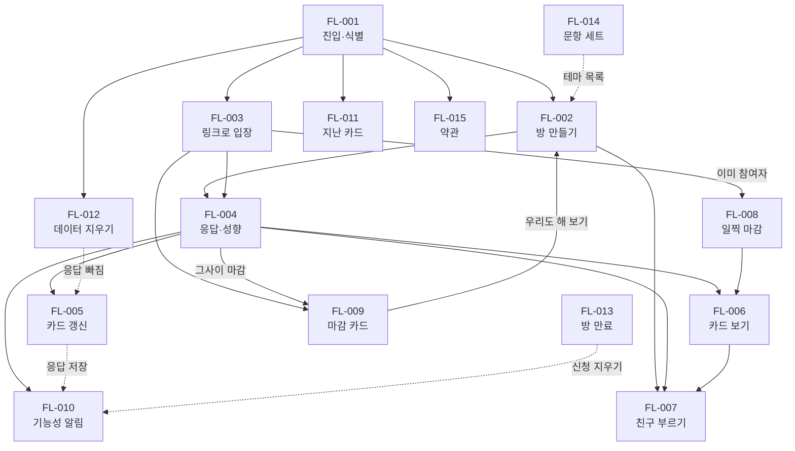

# 모임 합의 카드(가칭): 사용자 흐름 (03)

상태: **초안, 체크포인트 대기**(2026-11-28). 체크포인트 질문은 [checkpoint-03.md](checkpoint-03.md)에 있어요. 입력은 [02 요구사항](../02-prd/requirements.md)(REQ-001~082, 승인 main `20d6423`, DEC-008~014)과 [01 도메인 설계](../01-domain/domain.md)(CTX-001~006, TERM-001~042, 승인 main `9b5e401`)예요.

- 흐름 하나는 사용자가 가진 목표 하나예요. 파일마다 Mermaid 흐름도 한 장, 단계 표, 실패 경로가 있어요.
- 그림은 `corthex-diagram` 문법 버전 1로 그렸어요. 사각형은 단계, 마름모는 결정(가지마다 이름), 둥근 끝 상자는 시작·끝이나 이어지는 흐름이에요. 상자 안의 REQ ID가 그 단계가 맡는 요구사항이고, 단계 표에 같은 ID가 있어요.
- 화면 ID(SCR)는 07 사이트맵 뒤에 단계에 더해요.
- 사람이 보는 곳: 이 단계는 NEXUS 확정 없이 위임 답으로 통과를 기록해요(DEC-014). 저장소의 이 폴더가 원본이에요.

## 1. 흐름 목록

| FL | 흐름 | 누가 | 파일 | REQ 수 |
| --- | --- | --- | --- | --- |
| FL-001 | 미니앱 진입과 사용자 식별 | 모든 사용자(방장, 참여자, 처음 온 사람) | [FL-001-entry-identify.md](FL-001-entry-identify.md) | 15 |
| FL-002 | 방 만들기 | 방장 | [FL-002-create-room.md](FL-002-create-room.md) | 7 |
| FL-003 | 초대 링크로 입장 | 초대 링크를 받은 사용자 | [FL-003-join-by-invite.md](FL-003-join-by-invite.md) | 8 |
| FL-004 | 응답하고 내 모임 성향 받기 | 참여자(방장 포함) | [FL-004-answer-and-profile.md](FL-004-answer-and-profile.md) | 9 |
| FL-005 | 합의 카드 갱신과 자동 마감 | 서버(정책) | [FL-005-card-update.md](FL-005-card-update.md) | 13 |
| FL-006 | 합의 카드 보기·저장·공유 | 응답을 제출한 참여자 | [FL-006-view-save-card.md](FL-006-view-save-card.md) | 7 |
| FL-007 | 친구 부르기와 단톡방에 보내기 | 참여자(방장 포함) | [FL-007-share-invite.md](FL-007-share-invite.md) | 5 |
| FL-008 | 방장이 일찍 마감하기 | 방장 | [FL-008-host-close.md](FL-008-host-close.md) | 6 |
| FL-009 | 마감된 방의 최종 카드 보기 | 마감된 방의 초대 링크로 들어온 누구나 | [FL-009-closed-card.md](FL-009-closed-card.md) | 6 |
| FL-010 | 기능성 알림 신청과 받기 | 응답을 제출한 참여자, 서버 | [FL-010-notification.md](FL-010-notification.md) | 8 |
| FL-011 | 지난 카드 보기 | 참여자 | [FL-011-past-cards.md](FL-011-past-cards.md) | 1 |
| FL-012 | 내 데이터 지우기 | 사용자 | [FL-012-delete-my-data.md](FL-012-delete-my-data.md) | 7 |
| FL-013 | 방 만료 | 스케줄러(Cloudflare Cron Trigger) | [FL-013-expire-rooms.md](FL-013-expire-rooms.md) | 3 |
| FL-014 | 문항 세트 작성·검토·배포 | 운영자 | [FL-014-question-set-release.md](FL-014-question-set-release.md) | 13 |
| FL-015 | 약관과 개인정보처리방침 보기 | 사용자 | [FL-015-legal-docs.md](FL-015-legal-docs.md) | 2 |

## 2. 흐름 지도

그림 설명: 모든 사용자 흐름은 FL-001(진입·식별)에서 시작하고, 핵심 경로는 FL-002 → FL-004 → FL-005 → FL-006 → FL-007이에요. 실선은 사용자가 화면에서 넘어가는 경로, 점선은 서버 정책이나 운영으로 이어지는 일이에요. FL-013(만료)과 FL-014(문항 세트)는 사용자 화면 밖에서 일어나요.

## 3. 요구사항 연결 점검

검사 방법: 흐름 정의에서 단계마다 붙인 REQ ID를 모아 REQ-001~082와 맞춰 봤어요(스크립트 결과 2026-11-28). 결과: **82개 모두 연결, 빠진 것 0개.** 77개는 흐름의 단계에 붙고, 5개(REQ-062, REQ-063, REQ-067, REQ-072, REQ-081)는 한 단계가 아니라 모든 흐름에 걸려 아래 "공통"으로 연결했어요. 결정은 모두 가지 2개 이상에 이름이 있고, 흐름마다 끝이 있고, 시작에서 닿지 않는 단계가 0개예요.

### 3.1 모든 흐름에 걸리는 요구사항 (공통)

| REQ | 왜 공통인가 |
| --- | --- |
| REQ-062 | 어떤 흐름에도 인앱 광고 단계가 없음(첫 버전) |
| REQ-063 | 어떤 흐름에도 인앱 결제 단계가 없음(첫 버전) |
| REQ-022 | 카드와 내 모임 성향 모두 사람을 점수·순위로 나타내지 않음(FL-004, FL-005, FL-006에도 붙음) |
| REQ-065 | 모든 화면에서 토스 내비게이션 바의 뒤로가기만 씀(FL-003, FL-015에도 붙음) |
| REQ-067 | 버튼을 누른 뒤 P95 2초 안에 반응(모든 요청 단계) |
| REQ-072 | 본문 글자 명도 대비 4.5:1 이상(모든 화면) |
| REQ-081 | 누르는 영역 44×44pt 이상(모든 화면) |

### 3.2 요구사항별 흐름

| REQ | 흐름 |
| --- | --- |
| REQ-001 | FL-002, FL-014 |
| REQ-002 | FL-002 |
| REQ-003 | FL-002 |
| REQ-004 | FL-003 |
| REQ-005 | FL-003, FL-009 |
| REQ-006 | FL-003 |
| REQ-007 | FL-005 |
| REQ-008 | FL-008 |
| REQ-009 | FL-008 |
| REQ-010 | FL-008 |
| REQ-011 | FL-004 |
| REQ-012 | FL-004 |
| REQ-013 | FL-004 |
| REQ-014 | FL-006 |
| REQ-015 | FL-004, FL-005, FL-006 |
| REQ-016 | FL-003, FL-009 |
| REQ-017 | FL-005, FL-008, FL-009, FL-012 |
| REQ-018 | FL-005, FL-008, FL-012 |
| REQ-019 | FL-005, FL-006 |
| REQ-020 | FL-005, FL-006 |
| REQ-021 | FL-005, FL-006, FL-009 |
| REQ-022 | FL-005, FL-006, 공통 |
| REQ-023 | FL-005 |
| REQ-024 | FL-006 |
| REQ-025 | FL-005, FL-008, FL-011, FL-013 |
| REQ-026 | FL-004 |
| REQ-027 | FL-004 |
| REQ-028 | FL-004 |
| REQ-029 | FL-004 |
| REQ-030 | FL-014 |
| REQ-031 | FL-014 |
| REQ-032 | FL-014 |
| REQ-033 | FL-002, FL-014 |
| REQ-034 | FL-014 |
| REQ-035 | FL-014 |
| REQ-036 | FL-014 |
| REQ-037 | FL-002, FL-014 |
| REQ-038 | FL-014 |
| REQ-039 | FL-001 |
| REQ-040 | FL-001 |
| REQ-041 | FL-001 |
| REQ-042 | FL-001 |
| REQ-043 | FL-010, FL-012 |
| REQ-044 | FL-005, FL-012 |
| REQ-045 | FL-012 |
| REQ-046 | FL-012 |
| REQ-047 | FL-010, FL-013 |
| REQ-048 | FL-012 |
| REQ-049 | FL-002, FL-003 |
| REQ-050 | FL-015 |
| REQ-051 | FL-007 |
| REQ-052 | FL-007 |
| REQ-053 | FL-007 |
| REQ-054 | FL-007, FL-014 |
| REQ-055 | FL-003 |
| REQ-056 | FL-003, FL-009 |
| REQ-057 | FL-001 |
| REQ-058 | FL-005, FL-010 |
| REQ-059 | FL-010 |
| REQ-060 | FL-010 |
| REQ-061 | FL-004, FL-010 |
| REQ-062 | 공통 |
| REQ-063 | 공통 |
| REQ-064 | FL-001 |
| REQ-065 | FL-003, FL-015, 공통 |
| REQ-066 | FL-001 |
| REQ-067 | 공통 |
| REQ-068 | FL-001 |
| REQ-069 | FL-001, FL-010 |
| REQ-070 | FL-001 |
| REQ-071 | FL-005 |
| REQ-072 | 공통 |
| REQ-073 | FL-001 |
| REQ-074 | FL-001, FL-010 |
| REQ-075 | FL-001 |
| REQ-076 | FL-001 |
| REQ-077 | FL-001 |
| REQ-078 | FL-007, FL-014 |
| REQ-079 | FL-014 |
| REQ-080 | FL-013 |
| REQ-081 | 공통 |
| REQ-082 | FL-002, FL-009 |

## 4. 확인할 사실

02 requirements.md 3절의 F-1~F-3에 이어요. 고를 일이 아니라 공식 자료로 확인할 일이에요.

| # | 확인할 것 | 걸리는 흐름 | 지금 아는 것 |
| --- | --- | --- | --- |
| F-1 | 사업자 없이 콘솔에서 mTLS 인증서가 발급되나 | FL-001(코드 교환), FL-010(발송) | 02 3절 그대로예요. 콘솔 확인은 사용자님 계정이라 남아 있어요. |
| F-2 | 대표 전환 지표를 남기는 SDK 호출 | FL-005 | 02 3절 그대로예요. |
| F-3 | 문항 세트를 서버에서 내려 주면 번들 재검수 없이 테마를 더할 수 있나 | FL-014 | 02 3절 그대로예요. |
| F-4 | 기능성 알림 발송에 무엇을 보내나 | FL-010 | 2026-11-28 공식 개발자센터 검색 결과: 비로그인 사용자에게는 `x-anon-key` 헤더에 사용자 식별키를 넣어 보내요. 그래서 발송하려면 서버가 식별키를 알고 있어야 하고, REQ-074와 부딪혀요. 04 체크포인트 질문 2예요. |
