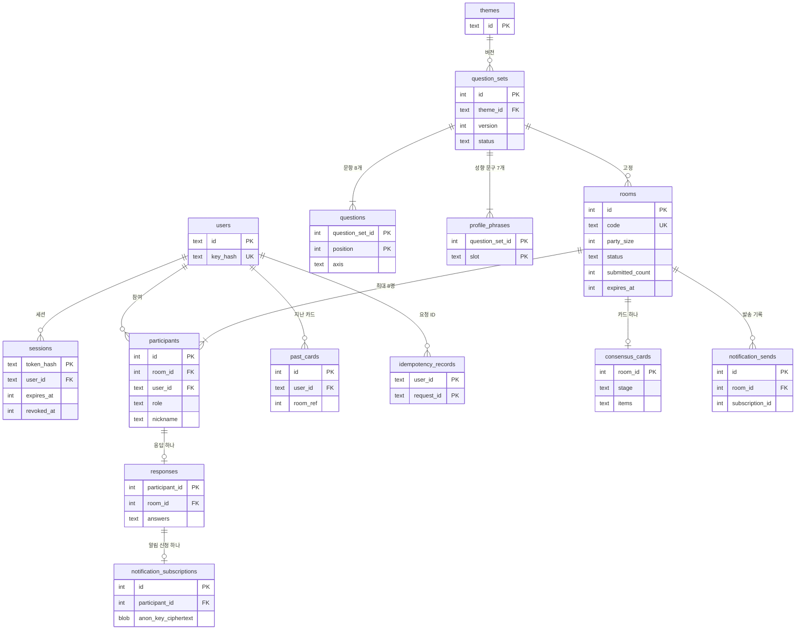

# 모임 합의 카드(가칭): ERD (05)

상태: **스키마 고정, 체크포인트 통과**(2026-11-28, DEC-022) · 변경: TBL-016 성향 문구를 더함(DEC-039, 0002), 참여자·알림 신청 ID 재사용 방지(DEC-049, 0003) · 원본: [db/schema.sql](../../db/schema.sql)(TBL-001~016) · 마이그레이션: [db/migrations/0001_init.sql](../../db/migrations/0001_init.sql), [0002_profile_phrases.sql](../../db/migrations/0002_profile_phrases.sql), [0003_notification_identity_sequences.sql](../../db/migrations/0003_notification_identity_sequences.sql) · 체크포인트 질문: [checkpoint-05.md](checkpoint-05.md)

- 입력: [04 기능 명세](../04-functional-spec/spec.md)(SPEC-001~039, DEC-016·020), [01 도메인 설계](../01-domain/domain.md)의 애그리거트 규칙과 용어집(TERM-001~046).
- 데이터베이스: Cloudflare D1(SQLite)이에요. 테이블은 모두 `STRICT`이고, 외래 키는 D1이 기본으로 지켜요. 한 요청의 여러 쓰기는 D1 batch 하나(트랜잭션 하나)로 보내요(C-4).
- 진실의 원천은 `db/schema.sql`이에요(`truth: source`). NEXUS가 이 파일로 ERD 그림을 그려요. 이 문서의 그림은 읽기 쉽게 줄인 것이고, 열·제약의 기준은 SQL이에요.
- 검사: `python3 scripts/check-contract.py`(마이그레이션 재생성, TBL ID, 제약 동작, SPEC 연결).

## 1. 그림

열은 키와 규칙에 걸리는 것만 보여요. 모든 열은 [schema.sql](../../db/schema.sql)에 있어요.

관계가 없는 테이블: `rate_counters`(TBL-014, 한도 계수), `entry_stats`(TBL-015, 유입 경로 집계). `past_cards.room_ref`와 `notification_sends`의 두 ID는 일부러 외래 키가 아니에요(방·신청이 지워져도 남아야 함).

## 2. 테이블

| ID | 테이블 | 컨텍스트 | 용어 | 무엇을 담나 | SPEC |
| --- | --- | --- | --- | --- | --- |
| TBL-001 | users | CTX-004 | TERM-034, TERM-029 | 사용자 ID와 식별키의 HMAC 해시. 식별키 원문 없음 | SPEC-002, SPEC-003, SPEC-029 |
| TBL-002 | sessions | CTX-004 | 없음 | 세션 토큰의 SHA-256 해시, 12시간 수명, 지운 사용자 표시 | SPEC-002, SPEC-029 |
| TBL-003 | themes | CTX-002 | TERM-007 | 테마 이름과 순서 | SPEC-004, SPEC-031, SPEC-032 |
| TBL-004 | question_sets | CTX-002 | TERM-008, TERM-036 | 배포된 문항 세트 버전, 테마 기본 문구, 내용 해시 | SPEC-004, SPEC-005, SPEC-031, SPEC-032 |
| TBL-005 | questions | CTX-002 | TERM-009, TERM-010, TERM-021, TERM-022, TERM-024, TERM-041, TERM-038 | 문항·선택지·조율 제안 문구·확정 문구·성향 축 | SPEC-010, SPEC-011, SPEC-012, SPEC-013, SPEC-031 |
| TBL-006 | rooms | CTX-001 | TERM-002, TERM-003, TERM-006, TERM-025, TERM-026, TERM-027, TERM-043, TERM-037, TERM-039 | 방 코드, 모임 이름, 인원, 고정한 세트, 상태, 계수, 보관 기한 | SPEC-005~007, SPEC-011, SPEC-014~018, SPEC-021, SPEC-029, SPEC-030, SPEC-039 |
| TBL-007 | participants | CTX-001 | TERM-005, TERM-004, TERM-030, TERM-046 | 방마다 참여자, 역할(방장·참여자), 닉네임 | SPEC-005~008, SPEC-010, SPEC-016, SPEC-017, SPEC-028, SPEC-029, SPEC-039 |
| TBL-008 | responses | CTX-001 | TERM-012, TERM-013, TERM-011 | 참여자마다 응답 하나(문항 8개 답 `A`·`B`·`N`) | SPEC-011~016, SPEC-019, SPEC-029 |
| TBL-009 | consensus_cards | CTX-001 | TERM-014~020 | 방마다 중간 카드 또는 최종 카드(문항별 수와 분류, 다음 행동) | SPEC-013~016, SPEC-019, SPEC-021, SPEC-029 |
| TBL-010 | past_cards | CTX-001 | TERM-044 | 응답한 사람마다 최종 카드 요약 사본. 방이 만료돼도 남음 | SPEC-015, SPEC-016, SPEC-027~030 |
| TBL-011 | notification_subscriptions | CTX-006 | TERM-035 | 알림 신청과 암호화한 식별키(AES-256-GCM) | SPEC-024~026, SPEC-028~030 |
| TBL-012 | notification_sends | CTX-006 | TERM-033 | 응답마다 발송 기록(결과·토스 오류 코드만) | SPEC-025 |
| TBL-013 | idempotency_records | 공통 | 없음 | 요청 ID와 첫 결과(24시간) | SPEC-005, SPEC-007, SPEC-011, SPEC-016, SPEC-024, SPEC-029 |
| TBL-014 | rate_counters | 공통 | 없음 | 토스 API·쓰기·방 만들기 한도 계수, 토스 API 1분 구간 기록 | SPEC-002, SPEC-005, SPEC-024, SPEC-025, SPEC-038 |
| TBL-015 | entry_stats | CTX-005 | 없음 | 날짜·유입 종류별 진입 수(사용자 값 없음) | SPEC-001, SPEC-023 |
| TBL-016 | profile_phrases | CTX-002 | TERM-024 | 문항 세트 버전마다 성향 문구 7개(축 3개의 '낮음'·'높음', '균형' 1개). 한 줄 설명의 출처(DEC-039) | SPEC-012, SPEC-031 |

테이블이 없는 용어: TERM-023 내 모임 성향(저장하지 않는 계산, REQ-029), TERM-040 점검 목록(저장소 파일), TERM-042 내 데이터 현황(여러 테이블을 세는 조회), TERM-045 금칙어 목록(번들 안 파일). 01 용어집의 나머지 리드 모델은 위 표의 테이블에 있어요: 테마 목록 TERM-036 → TBL-004, 방 소개 TERM-037·응답 현황 TERM-039 → TBL-006, 문항 화면 TERM-038 → TBL-005, 내 방 목록 TERM-046 → TBL-007.

## 3. 데이터베이스가 지키는 규칙

01 애그리거트 규칙과 04 명세 중 데이터베이스가 직접 막을 수 있는 것은 제약으로 옮겼어요. 나머지는 서버 코드가 지키고 06 계약과 12 QA가 확인해요.

| 규칙 | 출처 | 어떻게 |
| --- | --- | --- |
| 식별키 원문을 두지 않음, 같은 사용자는 하나 | REQ-074, SPEC-003 | TBL-001에 원문 열이 없음, `key_hash` UNIQUE |
| 세션 토큰은 해시만, 12시간 | DEC-017 | TBL-002 `token_hash`, `expires_at = created_at + 43200` CHECK |
| 배포된 버전은 바꾸지 않음 | 01 CTX-002, SPEC-031 | `(theme_id, version)` UNIQUE, 방이 쓰는 세트는 지울 수 없음(`ON DELETE RESTRICT`) |
| 성향 문구는 세트마다 자리 7개에 하나씩, 60자 안 | SPEC-031, DEC-039 | `(question_set_id, slot)` 기본 키, `slot` 7개 값 CHECK, `length` CHECK. "7개 모두 있음"은 형식 검사 스크립트 |
| 방 코드 형식 | C-5 | 31자 알파벳 10자 CHECK, UNIQUE |
| 인원 2~8, 참여자 최대 8명, 응답 완료 ≤ 인원 | 01 CTX-001, DEC-003 | `party_size`, `participant_count`, `submitted_count` CHECK |
| 열린 방 ↔ 마감 시각·이유 없음 | 01 CTX-001 | `(status = 'open') = (closed_at IS NULL)` CHECK |
| 보관 기간 30×24시간 | C-8, DEC-009 | `expires_at = created_at + 2592000` CHECK |
| 한 사용자는 한 방에 한 번, 방장은 한 명 | 01 CTX-001 | `(room_id, user_id)` UNIQUE, `role = 'host'` 부분 유일 인덱스 |
| 닉네임 1~10자, 모임 이름 1~20자, 앞뒤 공백 없음 | SPEC-005, SPEC-008 | `length` CHECK, `= trim(...)` CHECK. 금칙어는 서버 코드 |
| 응답은 참여자마다 하나, 문항 8개 모두 A·B·상관없어요 | 01 CTX-001, SPEC-011 | `participant_id` 기본 키, `answers` 8자 `[ABN]` CHECK |
| 응답의 방 = 참여자의 방 | 01 CTX-001 | `(participant_id, room_id)` 복합 외래 키 |
| 카드는 응답 완료 2명 이상일 때만, 방마다 하나 | 01 CTX-001 | `room_id` 기본 키, `based_on_count >= 2` CHECK |
| 최종 카드는 다시 바뀌지 않음 | 01 CTX-001, SPEC-015 | `stage = 'final'`이면 UPDATE를 막는 트리거 |
| 지난 카드는 사람·방마다 하나, 방이 만료돼도 남음 | SPEC-015, SPEC-027, DEC-009 | `(user_id, room_ref)` UNIQUE, 방 외래 키 없음 |
| 알림 신청은 응답 뒤에만, 참여자마다 하나 | SPEC-024 | `responses (participant_id, room_id)` 복합 외래 키, `participant_id` UNIQUE |
| 식별키는 암호문으로만, 방이 끝나면 지움 | DEC-019, REQ-084 | 평문 열 없음, 12바이트 nonce CHECK, 응답·참여자·방 삭제에 CASCADE |
| 같은 응답으로 두 번 보내지 않음 | SPEC-025 | `(subscription_id, trigger_participant_id)` UNIQUE |
| 내 데이터 지우기는 세션 표시 뒤 사용자 삭제 | SPEC-029 | `user_id IS NOT NULL OR revoked_at IS NOT NULL` CHECK + `ON DELETE SET NULL` |

## 4. 지우는 때

| 일 | 지워지는 것 | 남는 것 | SPEC |
| --- | --- | --- | --- |
| 내 데이터 지우기 | 내 응답·참여자 행(닉네임)·알림 신청·지난 카드·요청 ID 기록·사용자 ID 기준 한도 계수·사용자 행. 세션은 `revoked_at`을 적고 사용자 연결을 끊어 만료(12시간)까지 둠 | 확정된 최종 카드(TBL-009, 이름 없는 수), 발송 기록(TBL-012, 식별값 없음), 별도 HMAC 키로 만든 알림 한도 계수 한 행(논리적으로 1분, 물리 삭제는 약 2분 안, 정리 장애 시 더 길 수 있음, DEC-051) | SPEC-029 |
| 방 마감(자동·방장·방장 지우기) | 그 방의 알림 신청(같은 batch) | 방·응답·카드는 만료까지 | SPEC-015, SPEC-016, SPEC-026 |
| 방 만료(매시간, 30일) | 방과 CASCADE로 참여자·응답·카드·알림 신청·발송 기록 | 지난 카드(TBL-010) | SPEC-030 |
| 알림 한도 정리(매분) | 지난 분의 식별키 HMAC 한도 계수 | 현재 분의 한도 계수 | SPEC-025, SPEC-029 |
| 정리(매시간) | 끝난 세션, 24시간 지난 요청 ID 기록, 7일 지난 사용자·앱 한도 계수 | 유입 집계 | SPEC-002, SPEC-038 |

## 5. AI가 정한 것

질문 없이 AI가 정했어요(되돌리기 쉬움). 바꾸고 싶으면 번호로 말해 주세요. 체크포인트 파일에도 같은 목록이 있어요.

| # | 정한 것 | 이유 |
| --- | --- | --- |
| E-1 | 시각은 UTC Unix 초(INTEGER)로 둬요. | C-8, 비교·계산이 쉬움 |
| E-2 | 사용자 ID는 무작위 128비트(26자), 방·참여자·알림 신청 ID는 `AUTOINCREMENT` 정수예요(DEC-049). | 지난 카드와 알림 발송 기록의 참조 번호가 다시 쓰이지 않게 |
| E-3 | 응답은 문항별 행 대신 8자 문자열 하나(`A`·`B`·`N`)로 둬요. | 응답은 늘 8개를 한꺼번에 읽고 써요. 형식은 CHECK로 막아요 |
| E-4 | 카드 내용(문항별 수와 분류)은 JSON 열 하나로 둬요. 최종 카드는 트리거로 고정해요. | 카드는 한 번에 읽고, 최종 뒤에는 바뀌지 않아요 |
| E-5 | 문구 길이: 문항 40자, 선택지 30자, 조율 제안·확정·기본 문구·성향 문구(TBL-016, DEC-039) 60자, 테마 이름 20자. | 요구사항에 없는 한계라 AI가 정했어요. 형식 검사(SPEC-031)와 06 계약이 같은 수를 써요 |
| E-6 | 한도 계수(C-6)를 D1 테이블에 둬요(TBL-014). | 미니앱 전체 토스 API 한도(분당 3,000건)는 모든 Worker가 함께 세야 해요. 쓰기 요청마다 D1 쓰기가 하나 늘어요 |
| E-7 | 유입 경로는 서버에 날짜·종류별 수만 둬요(TBL-015). | SDK 로그는 토스의 `anonymous_key`를 자동으로 붙여 SPEC-023 [노출]과 맞지 않아요 |
| E-8 | 발송 기록(TBL-012)은 내 데이터를 지워도 남아요. 식별키·문구·닉네임 없이 신청 번호·응답자 번호·결과만 있어요. | 같은 응답으로 다시 보내지 않으려면 기록이 남아야 해요. 방이 만료되면 함께 지워져요 |
| E-9 | 문항 세트의 초안·검토 상태는 D1에 두지 않고 저장소 파일에 둬요. D1에는 배포된 세트만 와요. | 검토는 운영자가 저장소에서 해요(SPEC-032) |
| E-10 | 성향 문구 7개(DEC-039)는 TBL-004에 열 7개를 더하지 않고 새 테이블 TBL-016으로, `0001_init.sql`을 고치지 않고 새 마이그레이션 `0002_profile_phrases.sql`로 더해요. 높은 쪽 선택지는 이미 있는 `questions.axis_pole_a`로 나타내요('high'면 A, 'low'면 B). | 서버가 한 줄 설명을 내려면 문구가 D1에 있어야 해요(E-9, 배포 스크립트가 넣음). 적용된 마이그레이션은 고치지 않는 규칙(schema.sql 머리말)을 지키고, 기존 테이블과 열은 그대로예요 |
