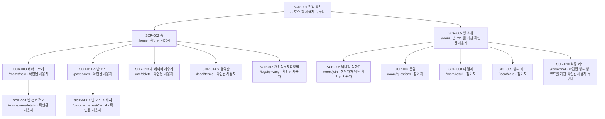

# 모임 합의 카드(가칭): 사이트맵 (07)

상태: **초안, 체크포인트 대기**(2026-11-28) · 원본: [sitemap.yaml](sitemap.yaml)(truth: source) · 보기 세 개(보드, 목록, 슬라이드): [sitemap.html](sitemap.html) · 체크포인트 질문: [checkpoint-07.md](checkpoint-07.md)

이 파일과 sitemap.html은 `python3 scripts/draw-screens.py`가 sitemap.yaml에서 그려요(그린 시각 2026-11-28 16:00 KST). 손으로 고치지 않아요.

## 보드

그림 설명: SCR-001(진입 확인)이 뿌리이고, 초대 링크 없이 열면 홈(SCR-002) 가지로, 초대 링크나 내 방 목록에서 방을 고르면 방 소개(SCR-005) 가지로 가요. 방 가지의 다섯 화면은 SCR-005가 방 상태를 보고 골라 보내요.

## 목록

| SCR | 화면 | 경로 | 누가 | 흐름 |
| --- | --- | --- | --- | --- |
| SCR-001 | 진입 확인 | `/` | 토스 앱 사용자 누구나(확인 전) | FL-001, FL-003 |
| SCR-002 | ↳ 홈 | `/home` | 확인된 사용자 | FL-001, FL-002, FL-011, FL-012, FL-015, FL-016 |
| SCR-003 | ↳ ↳ 테마 고르기 | `/rooms/new` | 확인된 사용자 | FL-002, FL-009 |
| SCR-004 | ↳ ↳ ↳ 방 정보 적기 | `/rooms/new/details` | 확인된 사용자(테마를 고른 뒤) | FL-002 |
| SCR-011 | ↳ ↳ 지난 카드 | `/past-cards` | 확인된 사용자(자기 지난 카드만) | FL-011 |
| SCR-012 | ↳ ↳ ↳ 지난 카드 자세히 | `/past-cards/:pastCardId` | 확인된 사용자(자기 지난 카드만) | FL-011 |
| SCR-013 | ↳ ↳ 내 데이터 지우기 | `/me/delete` | 확인된 사용자(자기 데이터만) | FL-012 |
| SCR-014 | ↳ ↳ 이용약관 | `/legal/terms` | 확인된 사용자 | FL-015 |
| SCR-015 | ↳ ↳ 개인정보처리방침 | `/legal/privacy` | 확인된 사용자 | FL-015 |
| SCR-005 | ↳ 방 소개 | `/room` | 방 코드를 가진 확인된 사용자(초대 링크 또는 내 방 목록) | FL-001, FL-003, FL-016 |
| SCR-006 | ↳ ↳ 닉네임 정하기 | `/room/join` | 참여자가 아닌 확인된 사용자(열린 방, 8명 미만) | FL-003 |
| SCR-007 | ↳ ↳ 문항 | `/room/questions` | 참여자(응답 전, 열린 방) | FL-002, FL-003, FL-004, FL-007 |
| SCR-008 | ↳ ↳ 내 결과 | `/room/result` | 참여자(응답 뒤) | FL-003, FL-004, FL-007, FL-010 |
| SCR-009 | ↳ ↳ 합의 카드 | `/room/card` | 참여자(응답 뒤, 열린 방). 마감하기는 방장만 | FL-006, FL-007, FL-008 |
| SCR-010 | ↳ ↳ 최종 카드 | `/room/final` | 마감된 방의 방 코드를 가진 확인된 사용자 누구나. 카드 저장·단톡방에 보내기는 응답한 참여자만 | FL-002, FL-004, FL-006, FL-007, FL-008, FL-009 |

## 화면이 없는 것

- 토스가 그리는 화면: 공유 시트(FL-007), 알림 동의문(FL-010), 내비게이션 바(뒤로가기·닫기). 흐름 단계 표의 SCR 칸에 "토스(…)"로 적었어요.
- 서버·운영 흐름: FL-005(카드 갱신), FL-013(방 만료), FL-014(문항 세트 배포, 저장소 스크립트). SCR 칸에 "서버"·"운영(저장소)"으로 적었어요.
- 화면이 없는 용어: TERM-008 문항 세트, TERM-040 점검 목록(운영자만 다룸).
